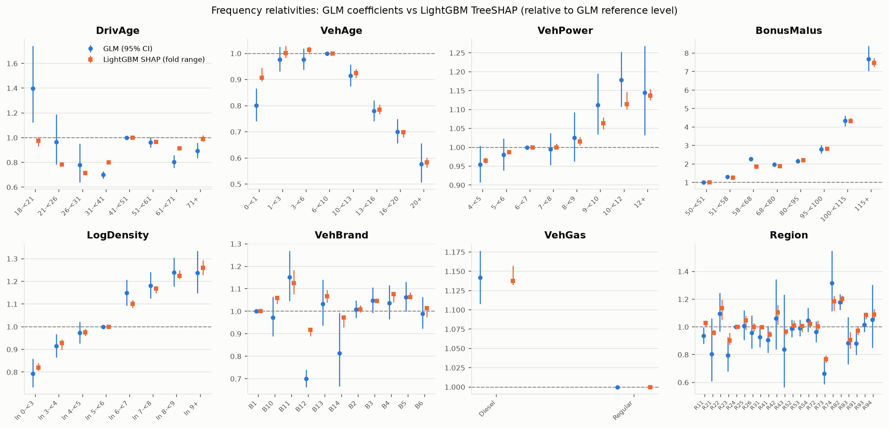
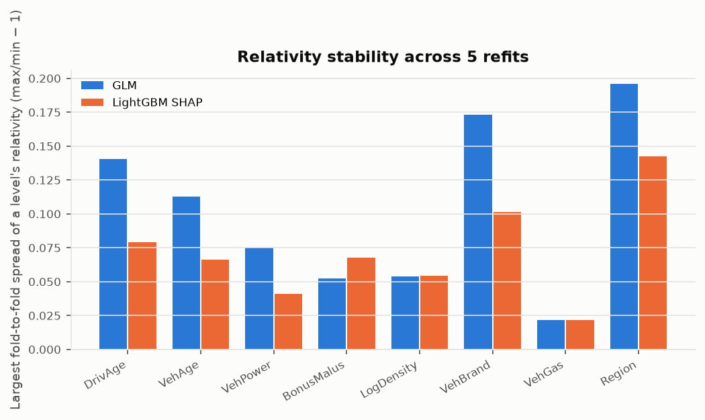
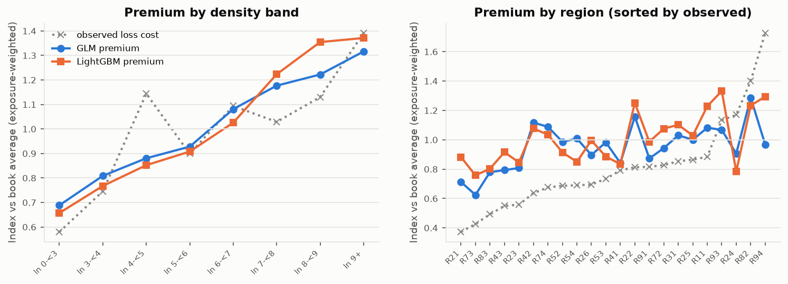

<!-- GENERATED by `fremtpl2 report` - do not edit by hand. -->
# Explainability, stability and fairness (phase 5)

Generated 2026-10-31. Training split only (no holdout). SHAP values are LightGBM's exact
TreeSHAP (`pred_contrib`) on the log-rate scale, on a sample of 50,000 training policies
priced at full-year cover. Interpretation: `docs/methodology.md` §3 and §6; decisions D-019, D-021, D-022.

## 1. GLM relativities vs LightGBM SHAP (frequency)

A SHAP "relativity" for a level is exp(mean SHAP in that level − mean SHAP in the GLM's reference level): the
marginal effect the tree attributes to the factor, with interactions shared out between features. It is
comparable to a GLM relativity, but it is not a tariff cell. The GLM's AgeMalus interaction has no separate SHAP
counterpart; LightGBM spreads that effect over DrivAge and BonusMalus.

| factor     | level    |   glm |   glm_ci_low |   glm_ci_high |   glm_fold_spread |   lgbm_shap |   lgbm_fold_min |   lgbm_fold_max |   lgbm_fold_spread |   lgbm_over_glm |   n_sample |
|:-----------|:---------|------:|-------------:|--------------:|------------------:|------------:|----------------:|----------------:|-------------------:|----------------:|-----------:|
| DrivAge    | 18-<21   | 1.398 |        1.123 |         1.741 |             0.140 |       0.974 |           0.931 |           1.004 |              0.079 |           0.697 |        508 |
| DrivAge    | 21-<26   | 0.966 |        0.785 |         1.189 |             0.089 |       0.783 |           0.770 |           0.797 |              0.034 |           0.810 |      2,351 |
| DrivAge    | 26-<31   | 0.779 |        0.638 |         0.951 |             0.090 |       0.715 |           0.697 |           0.723 |              0.036 |           0.918 |      4,875 |
| DrivAge    | 31-<41   | 0.700 |        0.671 |         0.730 |             0.019 |       0.802 |           0.793 |           0.804 |              0.013 |           1.146 |     12,688 |
| DrivAge    | 41-<51   | 1.000 |        1.000 |         1.000 |             0.000 |       1.000 |           1.000 |           1.000 |              0.000 |           1.000 |     12,137 |
| DrivAge    | 51-<61   | 0.962 |        0.921 |         1.005 |             0.024 |       0.964 |           0.953 |           0.969 |              0.017 |           1.002 |      9,873 |
| DrivAge    | 61-<71   | 0.805 |        0.756 |         0.858 |             0.035 |       0.914 |           0.905 |           0.921 |              0.017 |           1.136 |      4,685 |
| DrivAge    | 71+      | 0.894 |        0.834 |         0.959 |             0.073 |       0.989 |           0.969 |           1.021 |              0.053 |           1.107 |      2,883 |
| VehAge     | 0-<1     | 0.801 |        0.741 |         0.865 |             0.068 |       0.907 |           0.894 |           0.946 |              0.058 |           1.133 |      4,158 |
| VehAge     | 1-<3     | 0.977 |        0.932 |         1.025 |             0.044 |       1.001 |           0.983 |           1.028 |              0.046 |           1.024 |      9,606 |
| VehAge     | 3-<6     | 0.977 |        0.937 |         1.019 |             0.028 |       1.014 |           0.998 |           1.025 |              0.027 |           1.038 |      9,566 |
| VehAge     | 6-<10    | 1.000 |        1.000 |         1.000 |             0.000 |       1.000 |           1.000 |           1.000 |              0.000 |           1.000 |      9,950 |
| VehAge     | 10-<13   | 0.915 |        0.874 |         0.957 |             0.049 |       0.924 |           0.906 |           0.941 |              0.038 |           1.011 |      7,304 |
| VehAge     | 13-<16   | 0.779 |        0.741 |         0.820 |             0.055 |       0.785 |           0.768 |           0.804 |              0.047 |           1.008 |      5,605 |
| VehAge     | 16-<20   | 0.701 |        0.656 |         0.749 |             0.037 |       0.699 |           0.679 |           0.707 |              0.040 |           0.997 |      2,957 |
| VehAge     | 20+      | 0.576 |        0.506 |         0.656 |             0.113 |       0.583 |           0.563 |           0.600 |              0.066 |           1.011 |        854 |
| VehPower   | 4-<5     | 0.954 |        0.907 |         1.004 |             0.027 |       0.965 |           0.958 |           0.973 |              0.015 |           1.011 |      8,496 |
| VehPower   | 5-<6     | 0.980 |        0.939 |         1.023 |             0.017 |       0.987 |           0.985 |           0.993 |              0.008 |           1.007 |      9,304 |
| VehPower   | 6-<7     | 1.000 |        1.000 |         1.000 |             0.000 |       1.000 |           1.000 |           1.000 |              0.000 |           1.000 |     10,942 |
| VehPower   | 7-<8     | 0.995 |        0.954 |         1.038 |             0.026 |       1.000 |           0.998 |           1.010 |              0.012 |           1.005 |     10,789 |
| VehPower   | 8-<9     | 1.026 |        0.962 |         1.093 |             0.056 |       1.015 |           1.005 |           1.027 |              0.022 |           0.990 |      3,343 |
| VehPower   | 9-<10    | 1.112 |        1.034 |         1.196 |             0.053 |       1.063 |           1.048 |           1.079 |              0.030 |           0.956 |      2,278 |
| VehPower   | 10-<12   | 1.178 |        1.108 |         1.253 |             0.052 |       1.114 |           1.101 |           1.146 |              0.041 |           0.946 |      3,658 |
| VehPower   | 12+      | 1.144 |        1.033 |         1.268 |             0.075 |       1.136 |           1.124 |           1.155 |              0.027 |           0.993 |      1,190 |
| BonusMalus | 50-<51   | 1.000 |        1.000 |         1.000 |             0.000 |       1.000 |           1.000 |           1.000 |              0.000 |           1.000 |     28,238 |
| BonusMalus | 51-<58   | 1.295 |        1.225 |         1.370 |             0.051 |       1.249 |           1.239 |           1.283 |              0.036 |           0.965 |      5,051 |
| BonusMalus | 58-<68   | 2.269 |        2.160 |         2.382 |             0.034 |       1.848 |           1.812 |           1.911 |              0.055 |           0.815 |      4,584 |
| BonusMalus | 68-<80   | 1.979 |        1.872 |         2.091 |             0.049 |       1.869 |           1.829 |           1.901 |              0.039 |           0.945 |      4,815 |
| BonusMalus | 80-<95   | 2.153 |        2.030 |         2.284 |             0.036 |       2.207 |           2.189 |           2.237 |              0.022 |           1.025 |      3,969 |
| BonusMalus | 95-<100  | 2.793 |        2.573 |         3.031 |             0.042 |       2.828 |           2.752 |           2.939 |              0.068 |           1.013 |      1,309 |
| BonusMalus | 100-<115 | 4.332 |        4.053 |         4.629 |             0.052 |       4.328 |           4.229 |           4.508 |              0.066 |           0.999 |      1,730 |
| BonusMalus | 115+     | 7.674 |        7.025 |         8.384 |             0.046 |       7.480 |           7.262 |           7.750 |              0.067 |           0.975 |        304 |
| LogDensity | ln 0-<3  | 0.794 |        0.734 |         0.858 |             0.049 |       0.820 |           0.807 |           0.840 |              0.042 |           1.033 |      2,581 |
| LogDensity | ln 3-<4  | 0.914 |        0.864 |         0.967 |             0.054 |       0.927 |           0.899 |           0.944 |              0.050 |           1.014 |      5,743 |
| LogDensity | ln 4-<5  | 0.973 |        0.926 |         1.022 |             0.030 |       0.975 |           0.960 |           0.990 |              0.031 |           1.002 |      8,353 |
| LogDensity | ln 5-<6  | 1.000 |        1.000 |         1.000 |             0.000 |       1.000 |           1.000 |           1.000 |              0.000 |           1.000 |      8,706 |
| LogDensity | ln 6-<7  | 1.149 |        1.093 |         1.208 |             0.045 |       1.101 |           1.084 |           1.118 |              0.031 |           0.958 |      8,137 |
| LogDensity | ln 7-<8  | 1.182 |        1.125 |         1.242 |             0.026 |       1.167 |           1.148 |           1.179 |              0.026 |           0.988 |      7,199 |
| LogDensity | ln 8-<9  | 1.240 |        1.177 |         1.306 |             0.023 |       1.224 |           1.212 |           1.250 |              0.031 |           0.988 |      6,804 |
| LogDensity | ln 9+    | 1.238 |        1.148 |         1.336 |             0.048 |       1.260 |           1.228 |           1.294 |              0.054 |           1.018 |      2,477 |
| VehBrand   | B1       | 1.000 |        1.000 |         1.000 |             0.000 |       1.000 |           1.000 |           1.000 |              0.000 |           1.000 |     12,157 |
| VehBrand   | B10      | 0.973 |        0.889 |         1.065 |             0.056 |       1.059 |           1.032 |           1.065 |              0.031 |           1.088 |      1,256 |
| VehBrand   | B11      | 1.153 |        1.046 |         1.270 |             0.125 |       1.125 |           1.076 |           1.185 |              0.101 |           0.976 |      1,002 |
| VehBrand   | B12      | 0.701 |        0.663 |         0.740 |             0.018 |       0.917 |           0.890 |           0.920 |              0.034 |           1.309 |     12,047 |
| VehBrand   | B13      | 1.034 |        0.936 |         1.142 |             0.070 |       1.067 |           1.038 |           1.096 |              0.056 |           1.033 |        855 |
| VehBrand   | B14      | 0.813 |        0.666 |         0.993 |             0.173 |       0.972 |           0.929 |           0.976 |              0.051 |           1.195 |        276 |
| VehBrand   | B2       | 1.008 |        0.970 |         1.049 |             0.029 |       1.009 |           0.994 |           1.026 |              0.032 |           1.001 |     11,933 |
| VehBrand   | B3       | 1.048 |        0.993 |         1.106 |             0.028 |       1.046 |           1.037 |           1.055 |              0.017 |           0.999 |      3,927 |
| VehBrand   | B4       | 1.038 |        0.964 |         1.116 |             0.066 |       1.077 |           1.041 |           1.087 |              0.045 |           1.038 |      1,862 |
| VehBrand   | B5       | 1.063 |        0.999 |         1.132 |             0.039 |       1.064 |           1.057 |           1.084 |              0.025 |           1.000 |      2,546 |
| VehBrand   | B6       | 0.990 |        0.923 |         1.063 |             0.035 |       1.014 |           0.975 |           1.019 |              0.045 |           1.024 |      2,139 |
| VehGas     | Diesel   | 1.142 |        1.108 |         1.177 |             0.022 |       1.138 |           1.133 |           1.157 |              0.022 |           0.996 |     24,487 |
| VehGas     | Regular  | 1.000 |        1.000 |         1.000 |             0.000 |       1.000 |           1.000 |           1.000 |              0.000 |           1.000 |     25,513 |
| Region     | R11      | 0.936 |        0.878 |         0.998 |             0.057 |       1.029 |           1.000 |           1.046 |              0.046 |           1.100 |      5,158 |
| Region     | R21      | 0.803 |        0.608 |         1.061 |             0.066 |       0.958 |           0.942 |           0.980 |              0.040 |           1.192 |        213 |
| Region     | R22      | 1.097 |        0.965 |         1.246 |             0.171 |       1.135 |           1.052 |           1.196 |              0.137 |           1.035 |        588 |
| Region     | R23      | 0.794 |        0.680 |         0.927 |             0.073 |       0.903 |           0.872 |           0.957 |              0.097 |           1.137 |        629 |
| Region     | R24      | 1.000 |        1.000 |         1.000 |             0.000 |       1.000 |           1.000 |           1.000 |              0.000 |           1.000 |     11,842 |
| Region     | R25      | 1.008 |        0.905 |         1.122 |             0.095 |       1.045 |           0.979 |           1.080 |              0.104 |           1.037 |        774 |
| Region     | R26      | 0.956 |        0.844 |         1.084 |             0.046 |       1.001 |           0.968 |           1.028 |              0.062 |           1.046 |        745 |
| Region     | R31      | 0.928 |        0.854 |         1.007 |             0.067 |       0.996 |           0.992 |           1.017 |              0.025 |           1.074 |      2,042 |
| Region     | R41      | 0.905 |        0.814 |         1.006 |             0.071 |       0.946 |           0.923 |           0.971 |              0.052 |           1.045 |        962 |
| Region     | R42      | 1.061 |        0.837 |         1.345 |             0.196 |       1.104 |           1.016 |           1.161 |              0.142 |           1.041 |        171 |
| Region     | R43      | 0.837 |        0.567 |         1.235 |             0.155 |       0.968 |           0.941 |           0.978 |              0.039 |           1.157 |         86 |
| Region     | R52      | 0.989 |        0.928 |         1.054 |             0.072 |       1.009 |           0.975 |           1.046 |              0.073 |           1.020 |      2,817 |
| Region     | R53      | 0.991 |        0.934 |         1.052 |             0.057 |       1.008 |           0.963 |           1.018 |              0.058 |           1.017 |      3,057 |
| Region     | R54      | 1.047 |        0.964 |         1.138 |             0.044 |       1.022 |           0.994 |           1.052 |              0.058 |           0.976 |      1,421 |
| Region     | R72      | 0.963 |        0.892 |         1.041 |             0.103 |       1.004 |           0.967 |           1.046 |              0.082 |           1.042 |      2,212 |
| Region     | R73      | 0.665 |        0.586 |         0.754 |             0.069 |       0.768 |           0.744 |           0.795 |              0.068 |           1.156 |      1,224 |
| Region     | R74      | 1.315 |        1.115 |         1.551 |             0.122 |       1.184 |           1.117 |           1.226 |              0.097 |           0.900 |        355 |
| Region     | R82      | 1.178 |        1.124 |         1.236 |             0.046 |       1.203 |           1.166 |           1.227 |              0.052 |           1.021 |      6,388 |
| Region     | R83      | 0.885 |        0.730 |         1.072 |             0.165 |       0.905 |           0.845 |           0.962 |              0.139 |           1.023 |        398 |
| Region     | R91      | 0.880 |        0.798 |         0.969 |             0.076 |       0.973 |           0.944 |           1.008 |              0.068 |           1.106 |      2,688 |
| Region     | R93      | 1.017 |        0.963 |         1.074 |             0.038 |       1.086 |           1.057 |           1.105 |              0.046 |           1.068 |      5,886 |
| Region     | R94      | 1.053 |        0.851 |         1.303 |             0.118 |       1.088 |           1.048 |           1.129 |              0.077 |           1.033 |        344 |

How much each factor moves the log premium across the book (standard deviation of its log contribution):

| factor                     |   glm_sd_log_contribution |   lgbm_sd_shap |   lgbm_mean_abs_shap |
|:---------------------------|--------------------------:|---------------:|---------------------:|
| BonusMalus                 |                    0.4313 |         0.4405 |               0.3619 |
| VehBrand                   |                    0.1615 |         0.0635 |               0.0500 |
| DrivAge                    |                    0.1525 |         0.1352 |               0.1128 |
| AgeMalus (GLM interaction) |                    0.1341 |       nan      |             nan      |
| LogDensity                 |                    0.1263 |         0.1214 |               0.1022 |
| VehAge                     |                    0.1239 |         0.1298 |               0.1042 |
| Region                     |                    0.1054 |         0.0895 |               0.0626 |
| VehGas                     |                    0.0663 |         0.0669 |               0.0644 |
| VehPower                   |                    0.0577 |         0.0452 |               0.0294 |

## 2. Stability across refits

Both models were refitted on each of the five grouped-CV training sets (80% of the training split). The spread is
max/min − 1 of a level's relativity across the five refits:

| factor     |   levels |   glm_median_spread |   glm_max_spread |   lgbm_median_spread |   lgbm_max_spread |   max_abs_log_gap_lgbm_vs_glm |
|:-----------|---------:|--------------------:|-----------------:|---------------------:|------------------:|------------------------------:|
| DrivAge    |        8 |               0.054 |            0.140 |                0.026 |             0.079 |                         0.361 |
| VehAge     |        8 |               0.046 |            0.113 |                0.043 |             0.066 |                         0.125 |
| VehPower   |        8 |               0.039 |            0.075 |                0.019 |             0.041 |                         0.056 |
| BonusMalus |        8 |               0.044 |            0.052 |                0.047 |             0.068 |                         0.205 |
| LogDensity |        8 |               0.038 |            0.054 |                0.031 |             0.054 |                         0.043 |
| VehBrand   |       11 |               0.039 |            0.173 |                0.034 |             0.101 |                         0.269 |
| VehGas     |        2 |               0.011 |            0.022 |                0.011 |             0.022 |                         0.004 |
| Region     |       22 |               0.071 |            0.196 |                0.065 |             0.142 |                         0.176 |

Level averages smooth over many policies. What an individual customer would see is how much *their own* priced
frequency moves between the five refits (max/min − 1 per policy on the SHAP sample):

| model   |   median_max_min_spread |   p95_max_min_spread |   share_policies_spread_gt_10pct |   median_cv |
|:--------|------------------------:|---------------------:|---------------------------------:|------------:|
| glm     |                  0.0747 |               0.1537 |                           0.2551 |      0.0292 |
| lgbm    |                  0.1990 |               0.4067 |                           0.9006 |      0.0735 |

## 3. Monotonicity

Adjacent decreases in factors a filed tariff would normally rate monotonically (higher BonusMalus or density →
higher price). Full-training models:

| model                     | factor     |   adjacent_decreases |   largest_decrease |
|:--------------------------|:-----------|---------------------:|-------------------:|
| glm (full training)       | BonusMalus |                    1 |              0.290 |
| glm (full training)       | LogDensity |                    1 |              0.001 |
| lgbm SHAP (full training) | BonusMalus |                    0 |              0.000 |
| lgbm SHAP (full training) | LogDensity |                    0 |              0.000 |

Range across the five refits:

| kind   | factor     |   min |   max |
|:-------|:-----------|------:|------:|
| glm    | BonusMalus |     1 |     1 |
| glm    | LogDensity |     0 |     1 |
| lgbm   | BonusMalus |     0 |     1 |
| lgbm   | LogDensity |     0 |     0 |

## 4. Fairness: geography as a proxy

**Regulatory and fair-pricing context (high level).**
- *Gender.* EU Directive 2004/113/EC as interpreted by the CJEU in *Test-Achats* (C-236/09, 2011) requires
  unisex premiums and benefits for contracts concluded from 21 December 2012. freMTPL2 has no gender field, so the
  tariff cannot use gender directly. Rating factors correlated with gender (vehicle power and brand, for example)
  can still act as indirect proxies; this dataset cannot test for that.
- *Other protected and socioeconomic characteristics.* European anti-discrimination law and supervisory
  expectations (for example EIOPA's 2023 supervisory statement on differential pricing practices in non-life
  insurance) ask insurers to justify price differences by risk and cost, to monitor for proxy discrimination,
  and to avoid practices that treat groups of customers unfairly. Geography is the classic example: it carries
  real risk information (traffic density, theft, repair costs), but it also correlates with income and other
  characteristics customers cannot easily change.
- *What this section can and cannot show.* With no protected attributes in the data, it shows how much each
  model's prices depend on the geographic proxies, whether that dependence follows claims experience, and what
  removing it would cost and redistribute. It cannot show discrimination against any protected group.

### 4a. How much of the premium comes from geography

Share of the variance of log pure premium (priced, full-year) attributable to each factor:
cov(contribution, log premium) / var(log premium), so shares sum to 1 across factors (GLM: frequency and severity
terms; LightGBM: frequency and severity SHAP).

| factor     |   glm_share_of_log_premium_variance |   lgbm_share_of_log_premium_variance | geography   |
|:-----------|------------------------------------:|-------------------------------------:|:------------|
| BonusMalus |                               0.641 |                                0.583 | False       |
| VehBrand   |                               0.093 |                               -0.001 | False       |
| LogDensity |                               0.083 |                                0.059 | True        |
| VehAge     |                               0.080 |                                0.088 | False       |
| DrivAge    |                               0.054 |                                0.039 | False       |
| Region     |                               0.052 |                                0.045 | True        |
| VehGas     |                               0.016 |                                0.015 | False       |
| VehPower   |                               0.005 |                                0.009 | False       |
| AgeMalus   |                              -0.025 |                              nan     | False       |

### 4b. Premium dispersion by geography vs claims experience (training book)

Index = exposure-weighted average premium (or observed loss cost incl. large losses) in the level / book average.

| factor     | level   |   exposure |   glm_index |   lgbm_index |   obs_index |
|:-----------|:--------|-----------:|------------:|-------------:|------------:|
| Region     | R11     | 24,125.784 |       1.082 |        1.228 |       0.884 |
| Region     | R21     |    969.444 |       0.712 |        0.882 |       0.373 |
| Region     | R22     |  2,863.026 |       1.158 |        1.251 |       0.813 |
| Region     | R23     |  2,562.149 |       0.808 |        0.846 |       0.558 |
| Region     | R24     | 82,228.065 |       0.906 |        0.783 |       1.170 |
| Region     | R25     |  5,317.884 |       1.000 |        1.029 |       0.865 |
| Region     | R26     |  4,025.915 |       0.897 |        0.996 |       0.695 |
| Region     | R31     |  9,234.818 |       1.030 |        1.102 |       0.853 |
| Region     | R41     |  6,513.891 |       0.842 |        0.835 |       0.792 |
| Region     | R42     |    983.688 |       1.117 |        1.076 |       0.637 |
| Region     | R43     |    444.667 |       0.794 |        0.915 |       0.550 |
| Region     | R52     | 17,636.894 |       0.986 |        0.914 |       0.687 |
| Region     | R53     | 22,157.134 |       0.983 |        0.885 |       0.735 |
| Region     | R54     |  8,879.454 |       1.008 |        0.850 |       0.690 |
| Region     | R72     | 11,469.810 |       0.943 |        1.076 |       0.828 |
| Region     | R73     |  5,627.784 |       0.625 |        0.758 |       0.426 |
| Region     | R74     |  1,912.202 |       1.088 |        1.035 |       0.675 |
| Region     | R82     | 36,321.102 |       1.287 |        1.234 |       1.401 |
| Region     | R83     |  1,868.939 |       0.779 |        0.803 |       0.492 |
| Region     | R91     | 11,765.740 |       0.873 |        0.986 |       0.816 |
| Region     | R93     | 28,540.187 |       1.068 |        1.332 |       1.134 |
| Region     | R94     |  1,426.422 |       0.967 |        1.294 |       1.727 |
| LogDensity | ln 0-<3 | 17,270.938 |       0.689 |        0.657 |       0.580 |
| LogDensity | ln 3-<4 | 36,925.422 |       0.809 |        0.768 |       0.746 |
| LogDensity | ln 4-<5 | 50,007.271 |       0.881 |        0.852 |       1.144 |
| LogDensity | ln 5-<6 | 51,305.258 |       0.928 |        0.908 |       0.899 |
| LogDensity | ln 6-<7 | 45,632.602 |       1.081 |        1.026 |       1.094 |
| LogDensity | ln 7-<8 | 39,349.192 |       1.177 |        1.223 |       1.029 |
| LogDensity | ln 8-<9 | 34,231.177 |       1.222 |        1.355 |       1.130 |
| LogDensity | ln 9+   | 12,153.142 |       1.316 |        1.371 |       1.391 |

### 4c. Cost of removing geography (frequency GLM, grouped 5-fold CV)

| variant                    |   cv_mean_deviance |   cv_deviance_sd |   cv_gini |   cv_gini_sd |   gini_change_vs_full |
|:---------------------------|-------------------:|-----------------:|----------:|-------------:|----------------------:|
| full tariff                |            0.23839 |          0.00177 |   0.29065 |      0.00917 |               0.00000 |
| without Region             |            0.23865 |          0.00178 |   0.28947 |      0.00854 |              -0.00118 |
| without Region and density |            0.23923 |          0.00175 |   0.27377 |      0.00861 |              -0.01688 |

### 4d. Who would pay more or less without geography

Frequency GLM refitted without Region and density, rescaled to the same book premium (severity has no geographic
factor). 52.1% of exposure would see its premium move by more than 10%.

| factor     | level   |   exposure |   mean_premium_change |   share_up_more_than_10pct |   share_down_more_than_10pct |
|:-----------|:--------|-----------:|----------------------:|---------------------------:|-----------------------------:|
| Region     | R11     | 24,125.784 |                -0.032 |                      0.115 |                        0.096 |
| Region     | R21     |    969.444 |                 0.328 |                      0.867 |                        0.000 |
| Region     | R22     |  2,863.026 |                -0.072 |                      0.030 |                        0.470 |
| Region     | R23     |  2,562.149 |                 0.281 |                      0.849 |                        0.000 |
| Region     | R24     | 82,228.065 |                 0.091 |                      0.458 |                        0.091 |
| Region     | R25     |  5,317.884 |                 0.021 |                      0.241 |                        0.219 |
| Region     | R26     |  4,025.915 |                 0.144 |                      0.698 |                        0.033 |
| Region     | R31     |  9,234.818 |                 0.030 |                      0.293 |                        0.017 |
| Region     | R41     |  6,513.891 |                 0.064 |                      0.306 |                        0.000 |
| Region     | R42     |    983.688 |                -0.097 |                      0.007 |                        0.614 |
| Region     | R43     |    444.667 |                 0.291 |                      0.824 |                        0.000 |
| Region     | R52     | 17,636.894 |                 0.015 |                      0.246 |                        0.171 |
| Region     | R53     | 22,157.134 |                 0.024 |                      0.234 |                        0.116 |
| Region     | R54     |  8,879.454 |                 0.000 |                      0.138 |                        0.269 |
| Region     | R72     | 11,469.810 |                 0.058 |                      0.413 |                        0.106 |
| Region     | R73     |  5,627.784 |                 0.542 |                      1.000 |                        0.000 |
| Region     | R74     |  1,912.202 |                -0.143 |                      0.000 |                        0.725 |
| Region     | R82     | 36,321.102 |                -0.174 |                      0.011 |                        0.717 |
| Region     | R83     |  1,868.939 |                 0.203 |                      0.668 |                        0.000 |
| Region     | R91     | 11,765.740 |                 0.157 |                      0.607 |                        0.000 |
| Region     | R93     | 28,540.187 |                -0.059 |                      0.071 |                        0.496 |
| Region     | R94     |  1,426.422 |                 0.018 |                      0.245 |                        0.311 |
| LogDensity | ln 0-<3 | 17,270.938 |                 0.340 |                      0.969 |                        0.000 |
| LogDensity | ln 3-<4 | 36,925.422 |                 0.162 |                      0.881 |                        0.011 |
| LogDensity | ln 4-<5 | 50,007.271 |                 0.096 |                      0.381 |                        0.021 |
| LogDensity | ln 5-<6 | 51,305.258 |                 0.067 |                      0.259 |                        0.075 |
| LogDensity | ln 6-<7 | 45,632.602 |                -0.065 |                      0.028 |                        0.273 |
| LogDensity | ln 7-<8 | 39,349.192 |                -0.099 |                      0.021 |                        0.475 |
| LogDensity | ln 8-<9 | 34,231.177 |                -0.116 |                      0.039 |                        0.651 |
| LogDensity | ln 9+   | 12,153.142 |                -0.148 |                      0.000 |                        0.474 |
