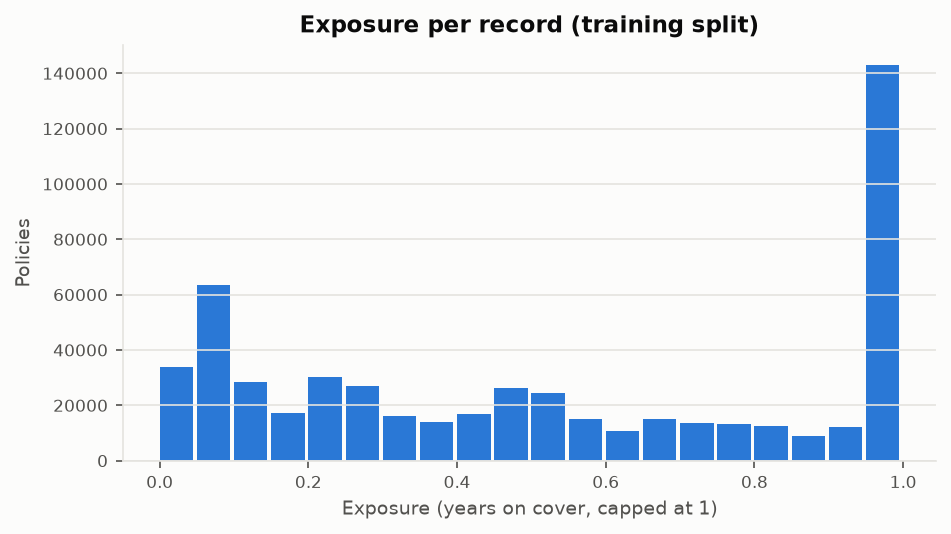
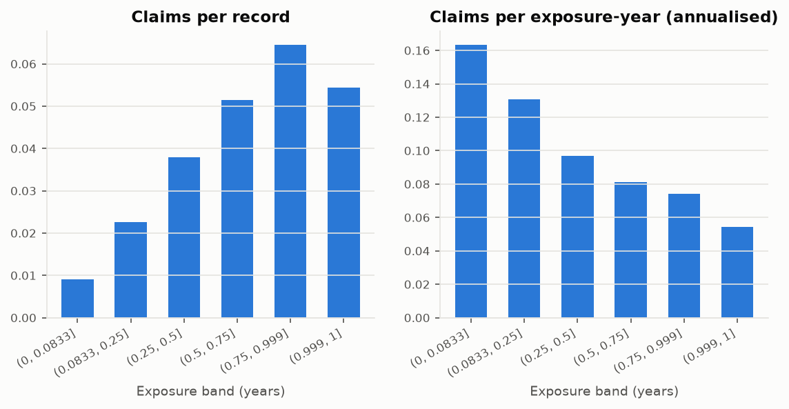
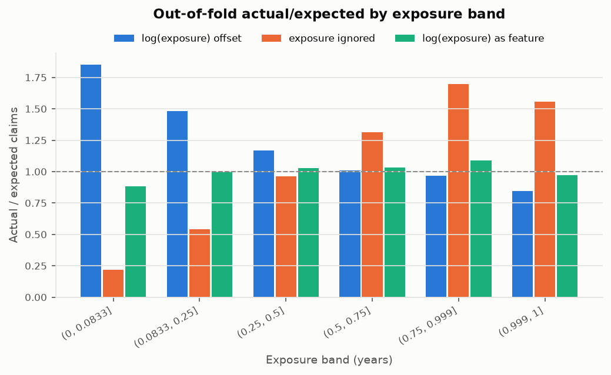
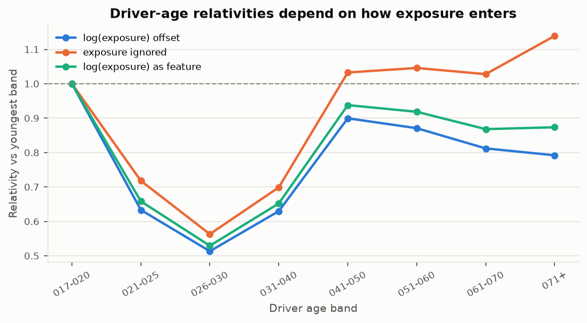

<!-- GENERATED by `fremtpl2 report` - do not edit by hand. -->
# Exposure analysis

Training split only. Models are Poisson GLMs on the same factors (BonusMalus_band, DrivAge_band, Area), fitted on folds 1-4 and
evaluated on fold 0. The holdout is not used. See `docs/methodology.md` section 1 for the interpretation.

## Claim counts scale with time at risk

| exposure_band   |   n_policies |   exposure_years |     claims |   claims_per_policy |   claims_per_year |   mean_driver_age |   mean_bonus_malus |   share_in_duplicate_group |
|:----------------|-------------:|-----------------:|-----------:|--------------------:|------------------:|------------------:|-------------------:|---------------------------:|
| (0, 0.0833]     |       91,825 |       5,064.4710 |   828.0000 |              0.0090 |            0.1635 |           42.8407 |            62.2617 |                     0.7194 |
| (0.0833, 0.25]  |       86,424 |      14,923.8300 | 1,952.0000 |              0.0226 |            0.1308 |           43.4608 |            62.4097 |                     0.4692 |
| (0.25, 0.5]     |      105,035 |      41,084.0600 | 3,986.0000 |              0.0379 |            0.0970 |           44.0962 |            61.8815 |                     0.4644 |
| (0.5, 0.75]     |       73,962 |      46,839.1600 | 3,805.0000 |              0.0514 |            0.0812 |           45.0908 |            60.3815 |                     0.4047 |
| (0.75, 0.999]   |       49,766 |      43,375.4800 | 3,213.0000 |              0.0646 |            0.0741 |           45.5418 |            59.2753 |                     0.3519 |
| (0.999, 1]      |      135,588 |     135,588.0000 | 7,368.0000 |              0.0543 |            0.0543 |           49.8754 |            54.5566 |                     0.0276 |

## Offset vs ignored vs free coefficient

Coefficient on log(exposure) when it is a free regressor (1 = proportional to time on cover):

|   coef |   ci_low |   ci_high |     se |
|-------:|---------:|----------:|-------:|
| 0.6696 |   0.6488 |    0.6905 | 0.0106 |

Out-of-fold actual/expected by exposure band (fold 0):

| exposure_band   |    policies |   exposure |    actual |   expected_offset |   expected_ignored |   expected_feature |   ae_offset |   ae_ignored |   ae_feature |
|:----------------|------------:|-----------:|----------:|------------------:|-------------------:|-------------------:|------------:|-------------:|-------------:|
| (0, 0.0833]     |  18,281.000 |  1,004.526 |   163.000 |            87.941 |            747.245 |            184.571 |       1.854 |        0.218 |        0.883 |
| (0.0833, 0.25]  |  17,273.000 |  2,971.540 |   384.000 |           259.019 |            710.468 |            383.475 |       1.483 |        0.540 |        1.001 |
| (0.25, 0.5]     |  21,085.000 |  8,241.030 |   832.000 |           712.193 |            865.049 |            810.422 |       1.168 |        0.962 |        1.027 |
| (0.5, 0.75]     |  14,823.000 |  9,371.300 |   766.000 |           757.346 |            582.671 |            742.294 |       1.011 |        1.315 |        1.032 |
| (0.75, 0.999]   |   9,886.000 |  8,628.910 |   639.000 |           660.453 |            376.027 |            586.149 |       0.968 |        1.699 |        1.090 |
| (0.999, 1]      |  27,137.000 | 27,137.000 | 1,457.000 |         1,726.033 |            934.580 |          1,500.918 |       0.844 |        1.559 |        0.971 |
| total           | 108,485.000 | 57,354.306 | 4,241.000 |         4,202.985 |          4,216.039 |          4,207.829 |       1.009 |        1.006 |        1.008 |

Annual claim frequency each model implies for a full policy year, averaged over fold 0 policies:

| model                              |   annual_frequency |
|:-----------------------------------|-------------------:|
| observed (claims / exposure years) |             0.0739 |
| offset                             |             0.0795 |
| ignored                            |             0.0389 |
| feature                            |             0.0671 |

Driver-age relativities and mean exposure per band (training folds 1-4):

| DrivAge_band   |   feature |   ignored |   offset |   policies |   mean_exposure |
|:---------------|----------:|----------:|---------:|-----------:|----------------:|
| 017-020        |     1.000 |     1.000 |    1.000 |      4,362 |           0.377 |
| 021-025        |     0.658 |     0.718 |    0.633 |     20,658 |           0.427 |
| 026-030        |     0.529 |     0.563 |    0.513 |     41,904 |           0.443 |
| 031-040        |     0.652 |     0.699 |    0.630 |    109,083 |           0.494 |
| 041-050        |     0.938 |     1.033 |    0.900 |    105,576 |           0.533 |
| 051-060        |     0.918 |     1.046 |    0.871 |     86,341 |           0.561 |
| 061-070        |     0.868 |     1.028 |    0.812 |     40,988 |           0.599 |
| 071+           |     0.873 |     1.139 |    0.792 |     25,203 |           0.683 |

Out-of-fold Poisson deviance (lower is better; not comparable to pricing usefulness, see methodology):

| model   |   validation_deviance |   deviance_vs_intercept_only |   n_params |
|:--------|----------------------:|-----------------------------:|-----------:|
| offset  |              26,461.6 |                     -1,673.2 |         18 |
| ignored |              27,534.9 |                       -599.9 |         18 |
| feature |              26,226.3 |                     -1,908.5 |         19 |
