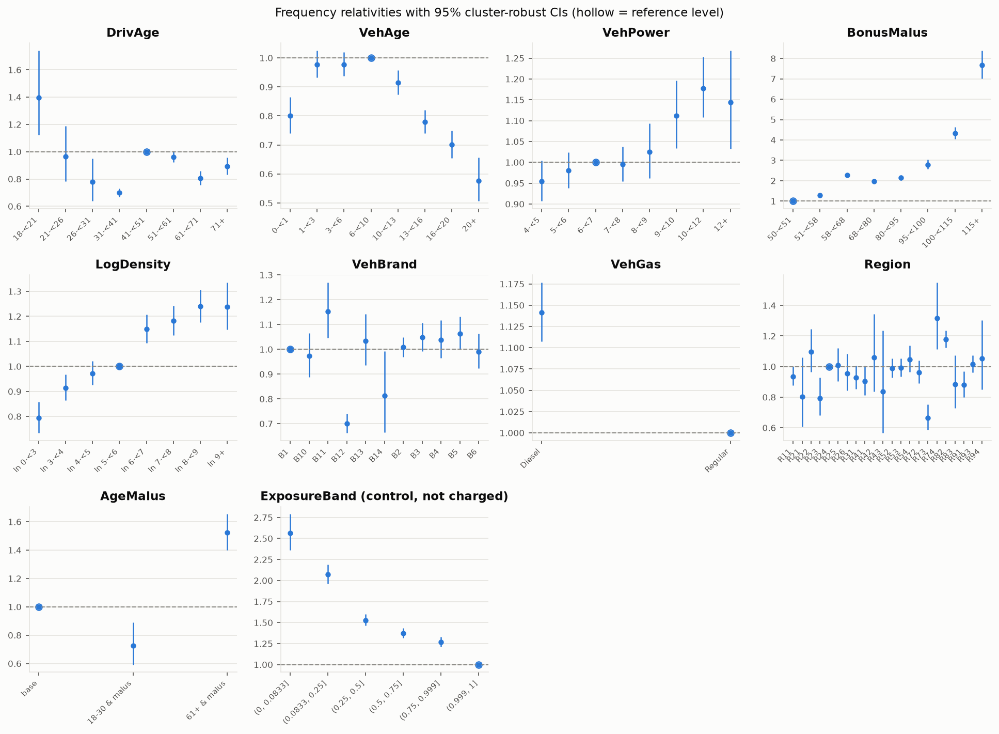
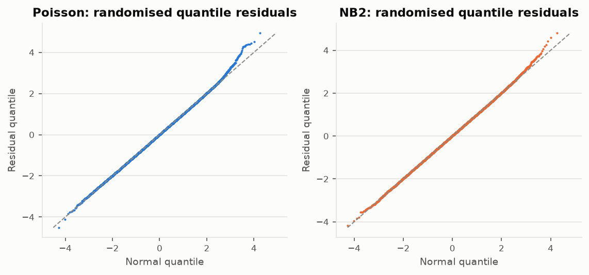
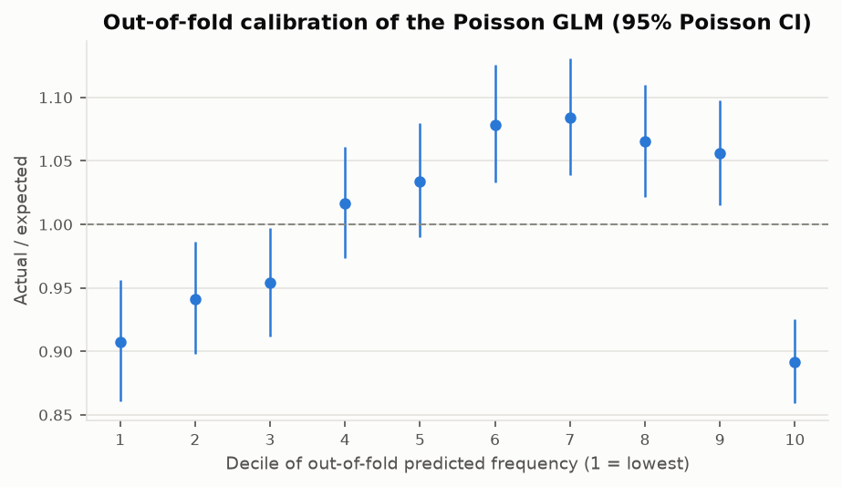

<!-- GENERATED by `fremtpl2 report` - do not edit by hand. -->
# Frequency model (phase 2)

Generated 2026-10-31. Training split only: 542,600 policies,
286,875 exposure-years, 21,152 claims. The holdout is not used.
Interpretation: `docs/methodology.md` §2; decisions D-009 to D-012.

Model (`glm_poisson`): Poisson GLM, log link, offset log(exposure), tariff factors DrivAge, VehAge, VehPower, BonusMalus, LogDensity, VehBrand, VehGas, Region, AgeMalus; control
factor(s) ExposureBand fitted but pinned at full-year cover when pricing (D-012). `glm_offset_only` is the same
tariff without the control (option A), kept as a comparator.
Base annual frequency for a full-year policy with all factors at reference level: **0.0482**.

## 1. Overdispersion

| test                             |   statistic | detail                                 |
|:---------------------------------|------------:|:---------------------------------------|
| Pearson chi2 / df                |      1.267  | chi2=687,374, df=542,525               |
| Deviance / df                    |      0.2381 |                                        |
| Cameron-Trivedi alpha (NB2 form) |      0.7086 | se=0.2276, t=3.11, one-sided p=0.00092 |

Where the Pearson statistic comes from (by exposure band):

| band           |   policies |    claims |   expected |   pearson_chi2 |   pearson_per_policy |   share_of_pearson_chi2 |
|:---------------|-----------:|----------:|-----------:|---------------:|---------------------:|------------------------:|
| (0, 0.0833]    |     91,825 |   828.000 |    828.000 |    189,645.992 |                2.065 |                   0.276 |
| (0.0833, 0.25] |     86,424 | 1,952.000 |  1,952.000 |    107,686.069 |                1.246 |                   0.157 |
| (0.25, 0.5]    |    105,035 | 3,986.000 |  3,986.000 |    127,572.477 |                1.215 |                   0.186 |
| (0.5, 0.75]    |     73,962 | 3,805.000 |  3,805.000 |     83,208.101 |                1.125 |                   0.121 |
| (0.75, 0.999]  |     49,766 | 3,213.000 |  3,213.000 |     54,105.888 |                1.087 |                   0.079 |
| (0.999, 1]     |    135,588 | 7,368.000 |  7,368.000 |    125,155.279 |                0.923 |                   0.182 |

NB2 vs Poisson (LR test of alpha = 0; p-value uses the 50:50 chi2(0)/chi2(1) boundary mixture):

| model   |   log_likelihood |       aic |   alpha |   n_params |   lr_vs_poisson |   p_boundary_mixture |
|:--------|-----------------:|----------:|--------:|-----------:|----------------:|---------------------:|
| Poisson |       -8.493e+04 | 1.7e+05   |   0     |         75 |           nan   |          nan         |
| NB2     |       -8.478e+04 | 1.697e+05 |   0.727 |         76 |           288.8 |            4.579e-65 |

Largest relativity difference between NB2 and Poisson, per factor:

| factor       |   max_abs_relativity_diff |
|:-------------|--------------------------:|
| DrivAge      |                    0.0030 |
| VehAge       |                    0.0052 |
| VehPower     |                    0.0019 |
| BonusMalus   |                    0.0171 |
| LogDensity   |                    0.0021 |
| VehBrand     |                    0.0050 |
| VehGas       |                    0.0006 |
| Region       |                    0.0045 |
| AgeMalus     |                    0.0011 |
| ExposureBand |                    0.0176 |

Standard errors relative to the Poisson model-based SE (all non-intercept coefficients):

| standard_error      |   mean_ratio |   min_ratio |   median_ratio |   max_ratio |
|:--------------------|-------------:|------------:|---------------:|------------:|
| poisson_model_based |        1.000 |       1.000 |          1.000 |       1.000 |
| quasi_poisson       |        1.126 |       1.126 |          1.126 |       1.126 |
| nb2                 |        1.023 |       1.006 |          1.023 |       1.080 |
| cluster_robust      |        1.035 |       0.977 |          1.029 |       1.289 |

## 2. Factor tests

Drop-one tests for model factors, add-one test for candidate factors. `lr_chi2` is the Poisson deviance
change; `quasi_F` scales it by the Pearson dispersion (1.267); `wald_chi2` uses the
cluster-robust covariance (groups = rating profiles).

| factor       | test            |   df |   lr_chi2 |       p_lr |   quasi_F |   p_quasi_F |   wald_chi2 |       p_wald |
|:-------------|:----------------|-----:|----------:|-----------:|----------:|------------:|------------:|-------------:|
| DrivAge      | drop from model |    7 |    475    | 1.9e-98    |    53.56  |   6.103e-77 |      453.5  |   7.96e-94   |
| VehAge       | drop from model |    7 |    278.9  | 1.892e-56  |    31.45  |   6.241e-44 |      256    |   1.439e-51  |
| VehPower     | drop from model |    7 |     59.46 | 1.938e-10  |     6.704 |   5.772e-08 |       55.27 |   1.316e-09  |
| BonusMalus   | drop from model |    7 |  3,042    | 0          |   343     |   0         |    3,394    |   0          |
| LogDensity   | drop from model |    7 |    244.3  | 4.614e-49  |    27.54  |   3.924e-38 |      228.1  |   1.285e-45  |
| VehBrand     | drop from model |   10 |    299    | 2.563e-58  |    23.6   |   4.92e-45  |      258.7  |   7.861e-50  |
| VehGas       | drop from model |    1 |     77.77 | 1.156e-18  |    61.38  |   4.706e-15 |       73.58 |   9.658e-18  |
| Region       | drop from model |   21 |    198.4  | 7.353e-31  |     7.458 |   9.689e-23 |      180.6  |   2.3e-27    |
| AgeMalus     | drop from model |    2 |    113    | 2.857e-25  |    44.61  |   4.262e-20 |      114    |   1.755e-25  |
| ExposureBand | drop from model |    5 |  1,127    | 1.536e-241 |   178     |   6.02e-190 |    1,006    |   2.391e-215 |
| Area         | add to model    |    5 |      9.42 | 0.09344    |     1.487 |   0.1903    |      nan    | nan          |

## 3. Relativities (cluster-robust 95% CI)

| factor     | level         | is_reference   |   relativity |   ci_low |   ci_high |    exposure |     claims |   observed_frequency |
|:-----------|:--------------|:---------------|-------------:|---------:|----------:|------------:|-----------:|---------------------:|
| DrivAge    | 18-<21        | False          |        1.398 |    1.123 |     1.741 |   2,065.352 |    495.000 |                0.240 |
| DrivAge    | 21-<26        | False          |        0.966 |    0.785 |     1.189 |  10,987.054 |  1,418.000 |                0.129 |
| DrivAge    | 26-<31        | False          |        0.779 |    0.638 |     0.951 |  23,234.421 |  1,893.000 |                0.081 |
| DrivAge    | 31-<41        | False          |        0.700 |    0.671 |     0.730 |  67,292.925 |  4,670.000 |                0.069 |
| DrivAge    | 41-<51        | True           |        1.000 |    1.000 |     1.000 |  70,442.091 |  5,377.000 |                0.076 |
| DrivAge    | 51-<61        | False          |        0.962 |    0.921 |     1.005 |  60,603.284 |  4,147.000 |                0.068 |
| DrivAge    | 61-<71        | False          |        0.805 |    0.756 |     0.858 |  30,706.440 |  1,865.000 |                0.061 |
| DrivAge    | 71+           | False          |        0.894 |    0.834 |     0.959 |  21,543.435 |  1,287.000 |                0.060 |
| VehAge     | 0-<1          | False          |        0.801 |    0.741 |     0.865 |  13,316.812 |    922.000 |                0.069 |
| VehAge     | 1-<3          | False          |        0.977 |    0.932 |     1.025 |  49,865.618 |  3,668.000 |                0.074 |
| VehAge     | 3-<6          | False          |        0.977 |    0.937 |     1.019 |  57,690.094 |  4,319.000 |                0.075 |
| VehAge     | 6-<10         | True           |        1.000 |    1.000 |     1.000 |  62,562.902 |  5,090.000 |                0.081 |
| VehAge     | 10-<13        | False          |        0.915 |    0.874 |     0.957 |  44,682.290 |  3,502.000 |                0.078 |
| VehAge     | 13-<16        | False          |        0.779 |    0.741 |     0.820 |  34,485.036 |  2,311.000 |                0.067 |
| VehAge     | 16-<20        | False          |        0.701 |    0.656 |     0.749 |  18,533.009 |  1,091.000 |                0.059 |
| VehAge     | 20+           | False          |        0.576 |    0.506 |     0.656 |   5,739.239 |    249.000 |                0.043 |
| VehPower   | 4-<5          | False          |        0.954 |    0.907 |     1.004 |  47,953.352 |  3,241.000 |                0.068 |
| VehPower   | 5-<6          | False          |        0.980 |    0.939 |     1.023 |  54,584.984 |  4,113.000 |                0.075 |
| VehPower   | 6-<7          | True           |        1.000 |    1.000 |     1.000 |  65,991.024 |  5,006.000 |                0.076 |
| VehPower   | 7-<8          | False          |        0.995 |    0.954 |     1.038 |  62,471.492 |  4,481.000 |                0.072 |
| VehPower   | 8-<9          | False          |        1.026 |    0.962 |     1.093 |  18,117.770 |  1,316.000 |                0.073 |
| VehPower   | 9-<10         | False          |        1.112 |    1.034 |     1.196 |  12,323.097 |    959.000 |                0.078 |
| VehPower   | 10-<12        | False          |        1.178 |    1.108 |     1.253 |  19,159.221 |  1,548.000 |                0.081 |
| VehPower   | 12+           | False          |        1.144 |    1.033 |     1.268 |   6,274.062 |    488.000 |                0.078 |
| BonusMalus | 50-<51        | True           |        1.000 |    1.000 |     1.000 | 180,276.906 |  9,305.000 |                0.052 |
| BonusMalus | 51-<58        | False          |        1.295 |    1.225 |     1.370 |  28,268.947 |  1,877.000 |                0.066 |
| BonusMalus | 58-<68        | False          |        2.269 |    2.160 |     2.382 |  23,936.250 |  2,847.000 |                0.119 |
| BonusMalus | 68-<80        | False          |        1.979 |    1.872 |     2.091 |  22,699.675 |  2,257.000 |                0.099 |
| BonusMalus | 80-<95        | False          |        2.153 |    2.030 |     2.284 |  18,305.959 |  1,966.000 |                0.107 |
| BonusMalus | 95-<100       | False          |        2.793 |    2.573 |     3.031 |   5,530.356 |    809.000 |                0.146 |
| BonusMalus | 100-<115      | False          |        4.332 |    4.053 |     4.629 |   6,404.249 |  1,510.000 |                0.236 |
| BonusMalus | 115+          | False          |        7.674 |    7.025 |     8.384 |   1,452.658 |    581.000 |                0.400 |
| LogDensity | ln 0-<3       | False          |        0.794 |    0.734 |     0.858 |  17,270.938 |    837.000 |                0.048 |
| LogDensity | ln 3-<4       | False          |        0.914 |    0.864 |     0.967 |  36,925.422 |  2,127.000 |                0.058 |
| LogDensity | ln 4-<5       | False          |        0.973 |    0.926 |     1.022 |  50,007.271 |  3,176.000 |                0.064 |
| LogDensity | ln 5-<6       | True           |        1.000 |    1.000 |     1.000 |  51,305.258 |  3,465.000 |                0.068 |
| LogDensity | ln 6-<7       | False          |        1.149 |    1.093 |     1.208 |  45,632.602 |  3,637.000 |                0.080 |
| LogDensity | ln 7-<8       | False          |        1.182 |    1.125 |     1.242 |  39,349.192 |  3,479.000 |                0.088 |
| LogDensity | ln 8-<9       | False          |        1.240 |    1.177 |     1.306 |  34,231.177 |  3,223.000 |                0.094 |
| LogDensity | ln 9+         | False          |        1.238 |    1.148 |     1.336 |  12,153.142 |  1,208.000 |                0.099 |
| VehBrand   | B1            | True           |        1.000 |    1.000 |     1.000 |  76,269.103 |  5,469.000 |                0.072 |
| VehBrand   | B10           | False          |        0.973 |    0.889 |     1.065 |   7,601.787 |    596.000 |                0.078 |
| VehBrand   | B11           | False          |        1.153 |    1.046 |     1.270 |   5,515.017 |    521.000 |                0.094 |
| VehBrand   | B12           | False          |        0.701 |    0.663 |     0.740 |  51,824.371 |  3,372.000 |                0.065 |
| VehBrand   | B13           | False          |        1.034 |    0.936 |     1.142 |   5,440.233 |    437.000 |                0.080 |
| VehBrand   | B14           | False          |        0.813 |    0.666 |     0.993 |   1,802.084 |    104.000 |                0.058 |
| VehBrand   | B2            | False          |        1.008 |    0.970 |     1.049 |  75,993.926 |  5,493.000 |                0.072 |
| VehBrand   | B3            | False          |        1.048 |    0.993 |     1.106 |  22,796.151 |  1,948.000 |                0.085 |
| VehBrand   | B4            | False          |        1.038 |    0.964 |     1.116 |  10,949.271 |    902.000 |                0.082 |
| VehBrand   | B5            | False          |        1.063 |    0.999 |     1.132 |  16,085.921 |  1,323.000 |                0.082 |
| VehBrand   | B6            | False          |        0.990 |    0.923 |     1.063 |  12,597.138 |    987.000 |                0.078 |
| VehGas     | Diesel        | False          |        1.142 |    1.108 |     1.177 | 136,450.386 | 10,760.000 |                0.079 |
| VehGas     | Regular       | True           |        1.000 |    1.000 |     1.000 | 150,424.615 | 10,392.000 |                0.069 |
| Region     | R11           | False          |        0.936 |    0.878 |     0.998 |  24,125.784 |  2,040.000 |                0.085 |
| Region     | R21           | False          |        0.803 |    0.608 |     1.061 |     969.444 |     56.000 |                0.058 |
| Region     | R22           | False          |        1.097 |    0.965 |     1.246 |   2,863.026 |    256.000 |                0.089 |
| Region     | R23           | False          |        0.794 |    0.680 |     0.927 |   2,562.149 |    171.000 |                0.067 |
| Region     | R24           | True           |        1.000 |    1.000 |     1.000 |  82,228.065 |  5,230.000 |                0.064 |
| Region     | R25           | False          |        1.008 |    0.905 |     1.122 |   5,317.884 |    373.000 |                0.070 |
| Region     | R26           | False          |        0.956 |    0.844 |     1.084 |   4,025.915 |    273.000 |                0.068 |
| Region     | R31           | False          |        0.928 |    0.854 |     1.007 |   9,234.818 |    754.000 |                0.082 |
| Region     | R41           | False          |        0.905 |    0.814 |     1.006 |   6,513.891 |    378.000 |                0.058 |
| Region     | R42           | False          |        1.061 |    0.837 |     1.345 |     983.688 |     79.000 |                0.080 |
| Region     | R43           | False          |        0.837 |    0.567 |     1.235 |     444.667 |     28.000 |                0.063 |
| Region     | R52           | False          |        0.989 |    0.928 |     1.054 |  17,636.894 |  1,258.000 |                0.071 |
| Region     | R53           | False          |        0.991 |    0.934 |     1.052 |  22,157.134 |  1,488.000 |                0.067 |
| Region     | R54           | False          |        1.047 |    0.964 |     1.138 |   8,879.454 |    642.000 |                0.072 |
| Region     | R72           | False          |        0.963 |    0.892 |     1.041 |  11,469.810 |    832.000 |                0.073 |
| Region     | R73           | False          |        0.665 |    0.586 |     0.754 |   5,627.784 |    282.000 |                0.050 |
| Region     | R74           | False          |        1.315 |    1.115 |     1.551 |   1,912.202 |    153.000 |                0.080 |
| Region     | R82           | False          |        1.178 |    1.124 |     1.236 |  36,321.102 |  3,424.000 |                0.094 |
| Region     | R83           | False          |        0.885 |    0.730 |     1.072 |   1,868.939 |    114.000 |                0.061 |
| Region     | R91           | False          |        0.880 |    0.798 |     0.969 |  11,765.740 |    828.000 |                0.070 |
| Region     | R93           | False          |        1.017 |    0.963 |     1.074 |  28,540.187 |  2,379.000 |                0.083 |
| Region     | R94           | False          |        1.053 |    0.851 |     1.303 |   1,426.422 |    114.000 |                0.080 |
| AgeMalus   | base          | True           |        1.000 |    1.000 |     1.000 | 245,215.933 | 16,322.000 |                0.067 |
| AgeMalus   | 18-30 & malus | False          |        0.726 |    0.593 |     0.890 |  34,373.623 |  3,708.000 |                0.108 |
| AgeMalus   | 61+ & malus   | False          |        1.522 |    1.401 |     1.654 |   7,285.445 |  1,122.000 |                0.154 |

Control factor (fitted, not charged; every policy is priced at the full-year level):

| factor       | level          | is_reference   |   relativity |   ci_low |   ci_high |    exposure |    claims |   observed_frequency |
|:-------------|:---------------|:---------------|-------------:|---------:|----------:|------------:|----------:|---------------------:|
| ExposureBand | (0, 0.0833]    | False          |        2.566 |    2.360 |     2.790 |   5,064.471 |   828.000 |                0.163 |
| ExposureBand | (0.0833, 0.25] | False          |        2.071 |    1.961 |     2.187 |  14,923.830 | 1,952.000 |                0.131 |
| ExposureBand | (0.25, 0.5]    | False          |        1.528 |    1.462 |     1.597 |  41,084.060 | 3,986.000 |                0.097 |
| ExposureBand | (0.5, 0.75]    | False          |        1.373 |    1.314 |     1.434 |  46,839.160 | 3,805.000 |                0.081 |
| ExposureBand | (0.75, 0.999]  | False          |        1.270 |    1.215 |     1.328 |  43,375.480 | 3,213.000 |                0.074 |
| ExposureBand | (0.999, 1]     | True           |        1.000 |    1.000 |     1.000 | 135,588.000 | 7,368.000 |                0.054 |

## 4. Residual checks

Out-of-fold actual/expected by decile of predicted frequency:

|   decile |    exposure |     actual |   expected |   predicted_frequency |   observed_frequency |     ae |   ae_ci_low |   ae_ci_high |
|---------:|------------:|-----------:|-----------:|----------------------:|---------------------:|-------:|------------:|-------------:|
|   1.0000 | 47,856.6700 | 1,402.0000 | 1,545.1960 |                0.0323 |               0.0293 | 0.9073 |      0.8605 |       0.9561 |
|   2.0000 | 43,996.5360 | 1,768.0000 | 1,878.3785 |                0.0427 |               0.0402 | 0.9412 |      0.8979 |       0.9862 |
|   3.0000 | 40,483.3749 | 1,946.0000 | 2,040.2618 |                0.0504 |               0.0481 | 0.9538 |      0.9119 |       0.9971 |
|   4.0000 | 34,954.2813 | 2,080.0000 | 2,045.6341 |                0.0585 |               0.0595 | 1.0168 |      0.9736 |       1.0615 |
|   5.0000 | 29,328.5297 | 2,072.0000 | 2,003.6184 |                0.0683 |               0.0706 | 1.0341 |      0.9901 |       1.0796 |
|   6.0000 | 24,487.3969 | 2,124.0000 | 1,969.0920 |                0.0804 |               0.0867 | 1.0787 |      1.0333 |       1.1255 |
|   7.0000 | 20,512.4486 | 2,141.0000 | 1,975.0771 |                0.0963 |               0.1044 | 1.0840 |      1.0386 |       1.1309 |
|   8.0000 | 17,878.1789 | 2,251.0000 | 2,113.0444 |                0.1182 |               0.1259 | 1.0653 |      1.0217 |       1.1102 |
|   9.0000 | 15,489.9442 | 2,516.0000 | 2,383.1294 |                0.1539 |               0.1624 | 1.0558 |      1.0149 |       1.0978 |
|  10.0000 | 11,887.6405 | 2,852.0000 | 3,197.5778 |                0.2690 |               0.2399 | 0.8919 |      0.8595 |       0.9253 |

## 5. Cross-validation against baselines (grouped 5-fold, out-of-fold)

Deviance uses each record's own fitted expectation (controls at the record's level):

| model                 |   oof_mean_deviance |   fold_sd |   deviance_explained_vs_portfolio_mean |   oof_ae_total |
|:----------------------|--------------------:|----------:|---------------------------------------:|---------------:|
| portfolio_mean        |             0.25318 |   0.00151 |                                0.00000 |        1.00001 |
| one_factor_BonusMalus |             0.24381 |   0.00181 |                                0.03702 |        1.00000 |
| glm_offset_only       |             0.24045 |   0.00198 |                                0.05030 |        1.00003 |
| glm_poisson           |             0.23839 |   0.00177 |                                0.05842 |        1.00005 |

**What each tariff would charge** (controls pinned at full year, pro rata to exposure), out-of-fold A/E.
Full-year cover is what is quoted, so the full-year row is the headline calibration check:

| model                 | scope             |   policies |     exposure |      actual |   charged_expected |     ae |   ae_ci_low |   ae_ci_high |
|:----------------------|:------------------|-----------:|-------------:|------------:|-------------------:|-------:|------------:|-------------:|
| portfolio_mean        | full-year records |    135,588 | 135,588.0000 |  7,368.0000 |         9,997.1417 | 0.7370 |      0.7203 |       0.7540 |
| portfolio_mean        | all records       |    542,600 | 286,875.0010 | 21,152.0000 |        21,151.8783 | 1.0000 |      0.9866 |       1.0136 |
| one_factor_BonusMalus | full-year records |    135,588 | 135,588.0000 |  7,368.0000 |         8,841.2654 | 0.8334 |      0.8144 |       0.8526 |
| one_factor_BonusMalus | all records       |    542,600 | 286,875.0010 | 21,152.0000 |        21,151.9840 | 1.0000 |      0.9866 |       1.0136 |
| glm_offset_only       | full-year records |    135,588 | 135,588.0000 |  7,368.0000 |         8,949.2089 | 0.8233 |      0.8046 |       0.8423 |
| glm_offset_only       | all records       |    542,600 | 286,875.0010 | 21,152.0000 |        21,151.4162 | 1.0000 |      0.9866 |       1.0136 |
| glm_poisson           | full-year records |    135,588 | 135,588.0000 |  7,368.0000 |         7,366.9483 | 1.0001 |      0.9774 |       1.0232 |
| glm_poisson           | all records       |    542,600 | 286,875.0010 | 21,152.0000 |        16,541.9615 | 1.2787 |      1.2615 |       1.2960 |

Paired comparison across the same folds (positive = `glm_poisson` has lower deviance):

| comparison                              |   mean_deviance_reduction |   fold_sd |   folds_improved |   t_stat |
|:----------------------------------------|--------------------------:|----------:|-----------------:|---------:|
| glm_offset_only minus glm_poisson       |                   0.00206 |   0.00035 |                5 | 13.24346 |
| one_factor_BonusMalus minus glm_poisson |                   0.00542 |   0.00036 |                5 | 33.86064 |
| portfolio_mean minus glm_poisson        |                   0.01479 |   0.00041 |                5 | 79.74772 |

By fold:

|   fold | model                 |   policies |     exposure |   mean_deviance |      ae |
|-------:|:----------------------|-----------:|-------------:|----------------:|--------:|
|      0 | portfolio_mean        |    108,485 | 57,354.30597 |         0.25388 | 1.00359 |
|      0 | one_factor_BonusMalus |    108,485 | 57,354.30597 |         0.24511 | 1.00780 |
|      0 | glm_offset_only       |    108,485 | 57,354.30597 |         0.24145 | 1.00974 |
|      0 | glm_poisson           |    108,485 | 57,354.30597 |         0.23913 | 1.00887 |
|      1 | portfolio_mean        |    108,496 | 57,204.35574 |         0.25142 | 0.98765 |
|      1 | one_factor_BonusMalus |    108,496 | 57,204.35574 |         0.24156 | 0.98648 |
|      1 | glm_offset_only       |    108,496 | 57,204.35574 |         0.23809 | 0.98526 |
|      1 | glm_poisson           |    108,496 | 57,204.35574 |         0.23601 | 0.98409 |
|      2 | portfolio_mean        |    108,543 | 57,502.87078 |         0.25536 | 1.01069 |
|      2 | one_factor_BonusMalus |    108,543 | 57,502.87078 |         0.24614 | 1.00978 |
|      2 | glm_offset_only       |    108,543 | 57,502.87078 |         0.24325 | 1.01131 |
|      2 | glm_poisson           |    108,543 | 57,502.87078 |         0.24083 | 1.01201 |
|      3 | portfolio_mean        |    108,664 | 57,543.10385 |         0.25287 | 1.01099 |
|      3 | one_factor_BonusMalus |    108,664 | 57,543.10385 |         0.24311 | 1.00498 |
|      3 | glm_offset_only       |    108,664 | 57,543.10385 |         0.23947 | 1.00511 |
|      3 | glm_poisson           |    108,664 | 57,543.10385 |         0.23793 | 1.00652 |
|      4 | portfolio_mean        |    108,412 | 57,270.36461 |         0.25236 | 0.98711 |
|      4 | one_factor_BonusMalus |    108,412 | 57,270.36461 |         0.24312 | 0.99094 |
|      4 | glm_offset_only       |    108,412 | 57,270.36461 |         0.23996 | 0.98878 |
|      4 | glm_poisson           |    108,412 | 57,270.36461 |         0.23803 | 0.98883 |

Out-of-fold actual/expected on segments the model does **not** contain (exact 95% Poisson CI):

| dimension            | segment          |   exposure |   actual |   expected |    ae |   ae_ci_low |   ae_ci_high | outside_95ci   |
|:---------------------|:-----------------|-----------:|---------:|-----------:|------:|------------:|-------------:|:---------------|
| Area (not in model)  | A                | 49,653.082 |    2,710 |  2,704.310 | 1.002 |       0.965 |        1.041 | False          |
| Area (not in model)  | B                | 34,355.103 |    2,126 |  2,148.798 | 0.989 |       0.948 |        1.032 | False          |
| Area (not in model)  | C                | 83,666.466 |    5,644 |  5,663.116 | 0.997 |       0.971 |        1.023 | False          |
| Area (not in model)  | D                | 61,761.782 |    5,177 |  5,197.238 | 0.996 |       0.969 |        1.024 | False          |
| Area (not in model)  | E                | 50,936.265 |    4,885 |  4,851.716 | 1.007 |       0.979 |        1.035 | False          |
| Area (not in model)  | F                |  6,502.302 |      610 |    585.831 | 1.041 |       0.960 |        1.127 | False          |
| DrivAge x BonusMalus | 18-<21 | BM=50   |    125.894 |       13 |     10.624 | 1.224 |       0.652 |        2.093 | False          |
| DrivAge x BonusMalus | 18-<21 | BM>50   |  1,939.459 |      482 |    484.209 | 0.995 |       0.909 |        1.088 | False          |
| DrivAge x BonusMalus | 21-<26 | BM=50   |    353.871 |       32 |     21.510 | 1.488 |       1.018 |        2.100 | True           |
| DrivAge x BonusMalus | 21-<26 | BM>50   | 10,633.183 |    1,386 |  1,395.634 | 0.993 |       0.941 |        1.047 | False          |
| DrivAge x BonusMalus | 26-<31 | BM=50   |  1,433.439 |       53 |     65.846 | 0.805 |       0.603 |        1.053 | False          |
| DrivAge x BonusMalus | 26-<31 | BM>50   | 21,800.982 |    1,840 |  1,826.478 | 1.007 |       0.962 |        1.055 | False          |
| DrivAge x BonusMalus | 31-<41 | BM=50   | 30,259.009 |    1,331 |  1,259.638 | 1.057 |       1.001 |        1.115 | True           |
| DrivAge x BonusMalus | 31-<41 | BM>50   | 37,033.915 |    3,339 |  3,410.759 | 0.979 |       0.946 |        1.013 | False          |
| DrivAge x BonusMalus | 41-<51 | BM=50   | 53,493.152 |    3,167 |  3,143.865 | 1.007 |       0.973 |        1.043 | False          |
| DrivAge x BonusMalus | 41-<51 | BM>50   | 16,948.939 |    2,210 |  2,233.243 | 0.990 |       0.949 |        1.032 | False          |
| DrivAge x BonusMalus | 51-<61 | BM=50   | 49,647.111 |    2,679 |  2,773.300 | 0.966 |       0.930 |        1.003 | False          |
| DrivAge x BonusMalus | 51-<61 | BM>50   | 10,956.173 |    1,468 |  1,373.324 | 1.069 |       1.015 |        1.125 | True           |
| DrivAge x BonusMalus | 61-<71 | BM=50   | 26,170.854 |    1,192 |  1,167.777 | 1.021 |       0.964 |        1.080 | False          |
| DrivAge x BonusMalus | 61-<71 | BM>50   |  4,535.586 |      673 |    697.825 | 0.964 |       0.893 |        1.040 | False          |
| DrivAge x BonusMalus | 71+ | BM=50      | 18,793.576 |      838 |    862.443 | 0.972 |       0.907 |        1.040 | False          |
| DrivAge x BonusMalus | 71+ | BM>50      |  2,749.859 |      449 |    424.534 | 1.058 |       0.962 |        1.160 | False          |
| VehAge x VehGas      | 0-<1 | Diesel    |  7,224.099 |      556 |    521.815 | 1.066 |       0.979 |        1.158 | False          |
| VehAge x VehGas      | 0-<1 | Regular   |  6,092.714 |      366 |    399.918 | 0.915 |       0.824 |        1.014 | False          |
| VehAge x VehGas      | 1-<3 | Diesel    | 26,400.772 |    2,056 |  2,035.355 | 1.010 |       0.967 |        1.055 | False          |
| VehAge x VehGas      | 1-<3 | Regular   | 23,464.846 |    1,612 |  1,633.162 | 0.987 |       0.939 |        1.036 | False          |
| VehAge x VehGas      | 10-<13 | Diesel  | 21,121.201 |    1,672 |  1,730.356 | 0.966 |       0.921 |        1.014 | False          |
| VehAge x VehGas      | 10-<13 | Regular | 23,561.089 |    1,830 |  1,771.018 | 1.033 |       0.986 |        1.082 | False          |
| VehAge x VehGas      | 13-<16 | Diesel  | 13,020.580 |      914 |    916.497 | 0.997 |       0.934 |        1.064 | False          |
| VehAge x VehGas      | 13-<16 | Regular | 21,464.455 |    1,397 |  1,394.305 | 1.002 |       0.950 |        1.056 | False          |
| VehAge x VehGas      | 16-<20 | Diesel  |  5,553.985 |      379 |    350.362 | 1.082 |       0.976 |        1.196 | False          |
| VehAge x VehGas      | 16-<20 | Regular | 12,979.024 |      712 |    740.731 | 0.961 |       0.892 |        1.034 | False          |
| VehAge x VehGas      | 20+ | Diesel     |  1,628.668 |       94 |     80.666 | 1.165 |       0.942 |        1.426 | False          |
| VehAge x VehGas      | 20+ | Regular    |  4,110.571 |      155 |    168.419 | 0.920 |       0.781 |        1.077 | False          |
| VehAge x VehGas      | 3-<6 | Diesel    | 28,747.022 |    2,276 |  2,302.325 | 0.989 |       0.948 |        1.030 | False          |
| VehAge x VehGas      | 3-<6 | Regular   | 28,943.073 |    2,043 |  2,016.117 | 1.013 |       0.970 |        1.058 | False          |
| VehAge x VehGas      | 6-<10 | Diesel   | 32,754.059 |    2,813 |  2,823.190 | 0.996 |       0.960 |        1.034 | False          |
| VehAge x VehGas      | 6-<10 | Regular  | 29,808.843 |    2,277 |  2,266.774 | 1.005 |       0.964 |        1.047 | False          |

Out-of-fold actual/expected by model factor level. Pooled across folds this is close to 1 for the GLM by
construction (each fold model nearly balances on its own factors), so it mainly shows what the baselines miss:

| factor       | level          |    exposure |   actual |   ae_portfolio_mean |   ae_one_factor_BonusMalus |   ae_glm_offset_only |   ae_glm_poisson |
|:-------------|:---------------|------------:|---------:|--------------------:|---------------------------:|---------------------:|-----------------:|
| DrivAge      | 18-<21         |   2,065.352 |      495 |               3.251 |                      1.350 |                1.000 |            1.000 |
| DrivAge      | 21-<26         |  10,987.054 |    1,418 |               1.750 |                      0.913 |                1.000 |            1.001 |
| DrivAge      | 26-<31         |  23,234.421 |    1,893 |               1.105 |                      0.744 |                1.000 |            1.000 |
| DrivAge      | 31-<41         |  67,292.925 |    4,670 |               0.941 |                      0.870 |                1.000 |            1.000 |
| DrivAge      | 41-<51         |  70,442.091 |    5,377 |               1.035 |                      1.187 |                1.000 |            1.000 |
| DrivAge      | 51-<61         |  60,603.284 |    4,147 |               0.928 |                      1.119 |                1.000 |            1.000 |
| DrivAge      | 61-<71         |  30,706.440 |    1,865 |               0.824 |                      1.020 |                1.000 |            1.000 |
| DrivAge      | 71+            |  21,543.435 |    1,287 |               0.810 |                      1.026 |                1.000 |            1.000 |
| VehAge       | 0-<1           |  13,316.812 |      922 |               0.939 |                      0.936 |                1.000 |            1.000 |
| VehAge       | 1-<3           |  49,865.618 |    3,668 |               0.998 |                      1.026 |                1.000 |            1.000 |
| VehAge       | 3-<6           |  57,690.094 |    4,319 |               1.015 |                      1.050 |                1.000 |            1.000 |
| VehAge       | 6-<10          |  62,562.902 |    5,090 |               1.103 |                      1.104 |                1.000 |            1.000 |
| VehAge       | 10-<13         |  44,682.290 |    3,502 |               1.063 |                      1.025 |                1.000 |            1.000 |
| VehAge       | 13-<16         |  34,485.036 |    2,311 |               0.909 |                      0.871 |                1.000 |            1.000 |
| VehAge       | 16-<20         |  18,533.009 |    1,091 |               0.798 |                      0.776 |                1.000 |            1.000 |
| VehAge       | 20+            |   5,739.239 |      249 |               0.588 |                      0.638 |                1.000 |            1.000 |
| VehPower     | 4-<5           |  47,953.352 |    3,241 |               0.917 |                      0.881 |                1.000 |            1.000 |
| VehPower     | 5-<6           |  54,584.984 |    4,113 |               1.022 |                      0.995 |                1.000 |            1.000 |
| VehPower     | 6-<7           |  65,991.024 |    5,006 |               1.029 |                      1.025 |                1.000 |            1.000 |
| VehPower     | 7-<8           |  62,471.492 |    4,481 |               0.973 |                      0.992 |                1.000 |            1.000 |
| VehPower     | 8-<9           |  18,117.770 |    1,316 |               0.985 |                      1.027 |                1.000 |            1.000 |
| VehPower     | 9-<10          |  12,323.097 |      959 |               1.055 |                      1.064 |                1.000 |            1.000 |
| VehPower     | 10-<12         |  19,159.221 |    1,548 |               1.096 |                      1.163 |                1.000 |            1.000 |
| VehPower     | 12+            |   6,274.062 |      488 |               1.055 |                      1.146 |                1.000 |            1.000 |
| BonusMalus   | 50-<51         | 180,276.906 |    9,305 |               0.700 |                      1.000 |                1.000 |            1.000 |
| BonusMalus   | 51-<58         |  28,268.947 |    1,877 |               0.901 |                      1.000 |                1.000 |            1.000 |
| BonusMalus   | 58-<68         |  23,936.250 |    2,847 |               1.613 |                      1.000 |                1.000 |            1.000 |
| BonusMalus   | 68-<80         |  22,699.675 |    2,257 |               1.349 |                      1.000 |                1.000 |            1.000 |
| BonusMalus   | 80-<95         |  18,305.959 |    1,966 |               1.457 |                      1.000 |                1.000 |            1.000 |
| BonusMalus   | 95-<100        |   5,530.356 |      809 |               1.984 |                      1.000 |                0.999 |            0.999 |
| BonusMalus   | 100-<115       |   6,404.249 |    1,510 |               3.198 |                      1.000 |                1.000 |            1.000 |
| BonusMalus   | 115+           |   1,452.658 |      581 |               5.424 |                      1.000 |                1.000 |            1.000 |
| LogDensity   | ln 0-<3        |  17,270.938 |      837 |               0.657 |                      0.722 |                1.000 |            1.000 |
| LogDensity   | ln 3-<4        |  36,925.422 |    2,127 |               0.781 |                      0.840 |                1.000 |            1.000 |
| LogDensity   | ln 4-<5        |  50,007.271 |    3,176 |               0.861 |                      0.905 |                1.000 |            1.000 |
| LogDensity   | ln 5-<6        |  51,305.258 |    3,465 |               0.916 |                      0.942 |                1.000 |            1.000 |
| LogDensity   | ln 6-<7        |  45,632.602 |    3,637 |               1.081 |                      1.076 |                1.000 |            1.000 |
| LogDensity   | ln 7-<8        |  39,349.192 |    3,479 |               1.199 |                      1.125 |                1.000 |            1.000 |
| LogDensity   | ln 8-<9        |  34,231.177 |    3,223 |               1.277 |                      1.156 |                1.000 |            1.000 |
| LogDensity   | ln 9+          |  12,153.142 |    1,208 |               1.348 |                      1.192 |                1.000 |            1.000 |
| VehBrand     | B1             |  76,269.103 |    5,469 |               0.973 |                      0.989 |                1.000 |            1.000 |
| VehBrand     | B10            |   7,601.787 |      596 |               1.063 |                      1.158 |                1.000 |            1.000 |
| VehBrand     | B11            |   5,515.017 |      521 |               1.281 |                      1.289 |                1.001 |            1.001 |
| VehBrand     | B12            |  51,824.371 |    3,372 |               0.882 |                      0.872 |                1.000 |            1.000 |
| VehBrand     | B13            |   5,440.233 |      437 |               1.089 |                      1.125 |                0.999 |            0.999 |
| VehBrand     | B14            |   1,802.084 |      104 |               0.783 |                      0.823 |                0.999 |            0.999 |
| VehBrand     | B2             |  75,993.926 |    5,493 |               0.980 |                      0.997 |                1.000 |            1.000 |
| VehBrand     | B3             |  22,796.151 |    1,948 |               1.159 |                      1.086 |                1.000 |            1.000 |
| VehBrand     | B4             |  10,949.271 |      902 |               1.117 |                      1.066 |                0.999 |            1.000 |
| VehBrand     | B5             |  16,085.921 |    1,323 |               1.115 |                      1.085 |                1.000 |            1.000 |
| VehBrand     | B6             |  12,597.138 |      987 |               1.063 |                      1.036 |                1.001 |            1.001 |
| VehGas       | Diesel         | 136,450.386 |   10,760 |               1.070 |                      1.078 |                1.000 |            1.000 |
| VehGas       | Regular        | 150,424.615 |   10,392 |               0.937 |                      0.930 |                1.000 |            1.000 |
| Region       | R11            |  24,125.784 |    2,040 |               1.147 |                      1.022 |                1.000 |            1.000 |
| Region       | R21            |     969.444 |       56 |               0.783 |                      0.739 |                1.001 |            1.002 |
| Region       | R22            |   2,863.026 |      256 |               1.213 |                      1.068 |                0.999 |            0.999 |
| Region       | R23            |   2,562.149 |      171 |               0.905 |                      0.876 |                1.000 |            1.000 |
| Region       | R24            |  82,228.065 |    5,230 |               0.863 |                      0.906 |                1.000 |            1.000 |
| Region       | R25            |   5,317.884 |      373 |               0.951 |                      0.980 |                1.001 |            1.001 |
| Region       | R26            |   4,025.915 |      273 |               0.920 |                      0.888 |                1.000 |            1.000 |
| Region       | R31            |   9,234.818 |      754 |               1.107 |                      0.983 |                1.000 |            1.000 |
| Region       | R41            |   6,513.891 |      378 |               0.787 |                      0.887 |                1.001 |            1.001 |
| Region       | R42            |     983.688 |       79 |               1.089 |                      1.066 |                1.004 |            1.004 |
| Region       | R43            |     444.667 |       28 |               0.854 |                      0.771 |                0.997 |            0.997 |
| Region       | R52            |  17,636.894 |    1,258 |               0.967 |                      0.984 |                0.999 |            0.999 |
| Region       | R53            |  22,157.134 |    1,488 |               0.911 |                      0.967 |                1.000 |            1.000 |
| Region       | R54            |   8,879.454 |      642 |               0.981 |                      0.978 |                1.000 |            1.000 |
| Region       | R72            |  11,469.810 |      832 |               0.984 |                      0.986 |                1.000 |            1.000 |
| Region       | R73            |   5,627.784 |      282 |               0.680 |                      0.673 |                1.000 |            1.000 |
| Region       | R74            |   1,912.202 |      153 |               1.085 |                      1.145 |                1.000 |            0.999 |
| Region       | R82            |  36,321.102 |    3,424 |               1.279 |                      1.239 |                1.000 |            1.000 |
| Region       | R83            |   1,868.939 |      114 |               0.827 |                      0.831 |                1.001 |            1.001 |
| Region       | R91            |  11,765.740 |      828 |               0.954 |                      0.933 |                1.000 |            1.000 |
| Region       | R93            |  28,540.187 |    2,379 |               1.131 |                      1.128 |                1.000 |            1.000 |
| Region       | R94            |   1,426.422 |      114 |               1.084 |                      0.993 |                0.999 |            1.000 |
| AgeMalus     | base           | 245,215.933 |   16,322 |               0.903 |                      1.019 |                1.000 |            1.000 |
| AgeMalus     | 18-30 & malus  |  34,373.623 |    3,708 |               1.463 |                      0.849 |                1.000 |            1.000 |
| AgeMalus     | 61+ & malus    |   7,285.445 |    1,122 |               2.089 |                      1.474 |                1.000 |            1.000 |
| ExposureBand | (0, 0.0833]    |   5,064.471 |      828 |               2.217 |                      1.907 |                1.889 |            1.000 |
| ExposureBand | (0.0833, 0.25] |  14,923.830 |    1,952 |               1.774 |                      1.516 |                1.539 |            1.000 |
| ExposureBand | (0.25, 0.5]    |  41,084.060 |    3,986 |               1.316 |                      1.147 |                1.141 |            1.000 |
| ExposureBand | (0.5, 0.75]    |  46,839.160 |    3,805 |               1.102 |                      1.010 |                1.031 |            1.000 |
| ExposureBand | (0.75, 0.999]  |  43,375.480 |    3,213 |               1.005 |                      0.960 |                0.971 |            1.000 |
| ExposureBand | (0.999, 1]     | 135,588.000 |    7,368 |               0.737 |                      0.833 |                0.823 |            1.000 |

## 6. Sensitivity of relativities to data decisions

Absolute change in relativity (|new/base - 1|) when refitting with an alternative choice:

| variant                                         | factor                     |   max_abs_relativity_change |   mean_abs_relativity_change |
|:------------------------------------------------|:---------------------------|----------------------------:|-----------------------------:|
| claim count = recorded ClaimNb (D-003)          | DrivAge                    |                      0.1447 |                       0.0629 |
| claim count = recorded ClaimNb (D-003)          | VehAge                     |                      2.0398 |                       0.3307 |
| claim count = recorded ClaimNb (D-003)          | VehPower                   |                      0.2909 |                       0.1388 |
| claim count = recorded ClaimNb (D-003)          | BonusMalus                 |                      0.2632 |                       0.2013 |
| claim count = recorded ClaimNb (D-003)          | LogDensity                 |                      0.1410 |                       0.0805 |
| claim count = recorded ClaimNb (D-003)          | VehBrand                   |                      0.5675 |                       0.0890 |
| claim count = recorded ClaimNb (D-003)          | VehGas                     |                      0.2041 |                       0.2041 |
| claim count = recorded ClaimNb (D-003)          | Region                     |                      0.2580 |                       0.1356 |
| claim count = recorded ClaimNb (D-003)          | AgeMalus                   |                      0.1723 |                       0.1044 |
| claim count = recorded ClaimNb (D-003)          | base frequency (intercept) |                      0.8070 |                       0.8070 |
| exposure-band control removed (option A, D-012) | DrivAge                    |                      0.0656 |                       0.0264 |
| exposure-band control removed (option A, D-012) | VehAge                     |                      0.1601 |                       0.0355 |
| exposure-band control removed (option A, D-012) | VehPower                   |                      0.0215 |                       0.0115 |
| exposure-band control removed (option A, D-012) | BonusMalus                 |                      0.1652 |                       0.0913 |
| exposure-band control removed (option A, D-012) | LogDensity                 |                      0.0161 |                       0.0086 |
| exposure-band control removed (option A, D-012) | VehBrand                   |                      0.0991 |                       0.0189 |
| exposure-band control removed (option A, D-012) | VehGas                     |                      0.0205 |                       0.0205 |
| exposure-band control removed (option A, D-012) | Region                     |                      0.1475 |                       0.0587 |
| exposure-band control removed (option A, D-012) | AgeMalus                   |                      0.0304 |                       0.0229 |
| exposure-band control removed (option A, D-012) | base frequency (intercept) |                      0.1365 |                       0.1365 |
