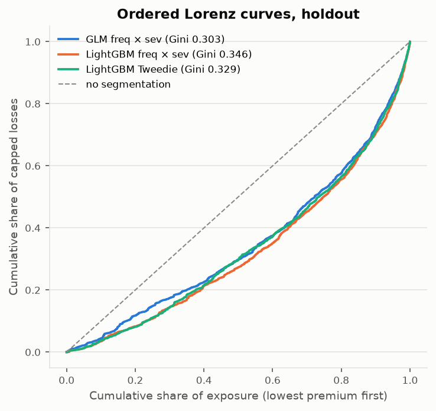
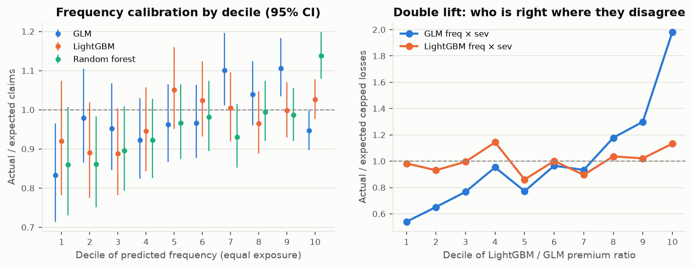

<!-- GENERATED by `fremtpl2 report` - do not edit by hand. -->
# Model comparison on the holdout (phase 4)

Generated 2026-10-31. Holdout: 135,413 policies, 71,485 exposure-years,
5,253 claims, 4,946 policies with claims. The holdout was not used for any
model or tuning decision. CIs are 95% percentile intervals from 200 grouped bootstrap replicates
(resampling whole rating-profile groups). Interpretation: `docs/methodology.md` §3–4; decisions D-018, D-019.

**Views.** *Fitted* = controls at each record's own exposure band (deviance, calibration, segment A/E).
*Priced* = controls pinned at full year, i.e. what the tariff charges pro rata (Gini, full-year A/E, disagreement).

## 1. Frequency (claim counts)

Mean Poisson deviance per policy (lower is better) and Gini of claims ordered by priced annual frequency:

| model                 |   deviance |   deviance_ci_low |   deviance_ci_high |   deviance_explained_vs_first |     gini |   gini_ci_low |   gini_ci_high |   gini_full_year |   gini_full_year_ci_low |   gini_full_year_ci_high |   ae_total_fitted |
|:----------------------|-----------:|------------------:|-------------------:|------------------------------:|---------:|--------------:|---------------:|-----------------:|------------------------:|-------------------------:|------------------:|
| portfolio_mean        |    0.25064 |           0.24548 |            0.25548 |                       0.00000 | -0.04919 |      -0.01557 |        0.01569 |         -0.03124 |                -0.02715 |                  0.02093 |           0.99663 |
| one_factor_BonusMalus |    0.24120 |           0.23608 |            0.24609 |                       0.03764 |  0.23045 |       0.21879 |        0.25720 |          0.29087 |                 0.27029 |                  0.32655 |           0.99450 |
| glm                   |    0.23637 |           0.23128 |            0.24108 |                       0.05693 |  0.29835 |       0.28223 |        0.31433 |          0.37780 |                 0.35402 |                  0.40479 |           0.99444 |
| rf                    |    0.23470 |           0.22964 |            0.23937 |                       0.06358 |  0.30956 |       0.29610 |        0.32636 |          0.39657 |                 0.37217 |                  0.42228 |           0.99539 |
| lgbm                  |    0.23082 |           0.22592 |            0.23537 |                       0.07905 |  0.33030 |       0.31593 |        0.34577 |          0.42458 |                 0.39889 |                  0.45211 |           0.99257 |

## 2. Severity (average capped claim, policies with claims)

Mean Gamma deviance per claim and Gini of claim cost ordered by predicted severity:

| model   |   deviance |   deviance_ci_low |   deviance_ci_high |   deviance_explained_vs_first |    gini |   gini_ci_low |   gini_ci_high |   ae_total |
|:--------|-----------:|------------------:|-------------------:|------------------------------:|--------:|--------------:|---------------:|-----------:|
| mean    |    1.13480 |           1.06258 |            1.20838 |                       0.00000 | 0.01611 |      -0.03058 |        0.02906 |    1.01085 |
| glm     |    1.09981 |           1.02622 |            1.17628 |                       0.03083 | 0.10586 |       0.07309 |        0.13021 |    1.01765 |
| lgbm    |    1.10072 |           1.02336 |            1.17234 |                       0.03003 | 0.10542 |       0.07748 |        0.13080 |    1.02732 |

## 3. Pure premium (capped loss cost)

Mean Tweedie deviance (p = 1.761) per exposure-year and Gini of capped losses ordered by priced
pure premium: `gini` uses all holdout records; `gini_full_year` only full-year records, i.e. the business that is
actually quoted and the only records on which a full-year premium can be validated. Several segments are almost
never seen at full year (see §6), so the all-records Gini partly rewards how a model spreads short-record cost.

| model           |   deviance |   deviance_ci_low |   deviance_ci_high |   deviance_explained_vs_first |     gini |   gini_ci_low |   gini_ci_high |   gini_full_year |   gini_full_year_ci_low |   gini_full_year_ci_high |   ae_total_fitted |
|:----------------|-----------:|------------------:|-------------------:|------------------------------:|---------:|--------------:|---------------:|-----------------:|------------------------:|-------------------------:|------------------:|
| portfolio_mean  |   31.84084 |          31.42132 |           32.34297 |                       0.00000 | -0.03375 |      -0.04027 |        0.03205 |         -0.01821 |                -0.06086 |                  0.04712 |           1.00559 |
| glm_freq_x_sev  |   30.26355 |          29.87496 |           30.84442 |                       0.04954 |  0.30297 |       0.26414 |        0.34398 |          0.39647 |                 0.33347 |                  0.45652 |           1.00549 |
| glm_tweedie     |   30.27392 |          29.84513 |           30.83792 |                       0.04921 |  0.30291 |       0.26474 |        0.34417 |          0.41020 |                 0.35250 |                  0.46628 |           1.00294 |
| lgbm_freq_x_sev |   29.85572 |          29.40660 |           30.39212 |                       0.06235 |  0.34645 |       0.31386 |        0.38024 |          0.46663 |                 0.41127 |                  0.52385 |           1.01606 |
| lgbm_tweedie    |   29.98121 |          29.50302 |           30.61241 |                       0.05840 |  0.32877 |       0.29773 |        0.36309 |          0.45157 |                 0.39739 |                  0.50366 |           1.12673 |

Paired bootstrap differences (CI excluding 0 = a real difference on this holdout):

| statistic                                               |   estimate |   ci_low |   ci_high |   boot_sd |
|:--------------------------------------------------------|-----------:|---------:|----------:|----------:|
| diff|freq_deviance glm - lgbm                           |    0.00554 |  0.00479 |   0.00628 |   0.00040 |
| diff|pp_gini lgbm_freq_x_sev - glm_freq_x_sev           |    0.04348 |  0.02578 |   0.06482 |   0.01035 |
| diff|pp_gini lgbm_tweedie - glm_freq_x_sev              |    0.02580 |  0.00908 |   0.04381 |   0.00942 |
| diff|freq_gini lgbm - glm                               |    0.03195 |  0.02290 |   0.04338 |   0.00513 |
| diff|pp_gini_full_year lgbm_freq_x_sev - glm_freq_x_sev |    0.07016 |  0.04812 |   0.09585 |   0.01393 |
| diff|sev_deviance glm - lgbm                            |   -0.00091 | -0.01089 |   0.00979 |   0.00563 |

## 4. Calibration

Full-year calibration of what each tariff charges, and the book-level shortfall of pricing every record pro rata
at the full-year rate (the short-record effect, D-012/D-014):

| target       | model                 |   ae_full_year_records |   ae_all_records_pro_rata |
|:-------------|:----------------------|-----------------------:|--------------------------:|
| frequency    | portfolio_mean        |                 0.7637 |                    0.9966 |
| frequency    | one_factor_BonusMalus |                 0.8585 |                    0.9945 |
| frequency    | glm                   |                 1.0280 |                    1.2703 |
| frequency    | rf                    |                 1.0283 |                    1.1294 |
| frequency    | lgbm                  |                 1.0149 |                    1.1255 |
| pure premium | portfolio_mean        |                 0.6247 |                    1.0056 |
| pure premium | glm_freq_x_sev        |                 1.0373 |                    1.5735 |
| pure premium | glm_tweedie           |                 1.1584 |                    1.7227 |
| pure premium | lgbm_freq_x_sev       |                 1.0057 |                    1.3495 |
| pure premium | lgbm_tweedie          |                 1.1457 |                    1.5347 |

Frequency calibration by decile of predicted frequency (equal exposure per decile):

|   bin |   exposure |     actual |   expected |   predicted_rate |   observed_rate |     ae |   ae_ci_low |   ae_ci_high | model   |
|------:|-----------:|-----------:|-----------:|-----------------:|----------------:|-------:|------------:|-------------:|:--------|
|     1 | 7,148.0700 |   176.0000 |   211.3659 |           0.0296 |          0.0246 | 0.8327 |      0.7142 |       0.9652 | glm     |
|     2 | 7,148.2800 |   264.0000 |   269.6167 |           0.0377 |          0.0369 | 0.9792 |      0.8646 |       1.1047 | glm     |
|     3 | 7,149.0356 |   294.0000 |   308.9149 |           0.0432 |          0.0411 | 0.9517 |      0.8460 |       1.0670 | glm     |
|     4 | 7,148.3247 |   319.0000 |   345.9332 |           0.0484 |          0.0446 | 0.9221 |      0.8237 |       1.0291 | glm     |
|     5 | 7,148.6596 |   370.0000 |   384.5429 |           0.0538 |          0.0518 | 0.9622 |      0.8666 |       1.0654 | glm     |
|     6 | 7,147.8726 |   420.0000 |   434.4570 |           0.0608 |          0.0588 | 0.9667 |      0.8765 |       1.0638 | glm     |
|     7 | 7,149.1117 |   553.0000 |   502.5251 |           0.0703 |          0.0774 | 1.1004 |      1.0106 |       1.1961 | glm     |
|     8 | 7,148.6608 |   629.0000 |   604.9536 |           0.0846 |          0.0880 | 1.0397 |      0.9601 |       1.1243 | glm     |
|     9 | 7,148.5751 |   872.0000 |   788.1905 |           0.1103 |          0.1220 | 1.1063 |      1.0341 |       1.1823 | glm     |
|    10 | 7,148.5143 | 1,356.0000 | 1,431.8667 |           0.2003 |          0.1897 | 0.9470 |      0.8973 |       0.9988 | glm     |

|   bin |   exposure |     actual |   expected |   predicted_rate |   observed_rate |     ae |   ae_ci_low |   ae_ci_high | model   |
|------:|-----------:|-----------:|-----------:|-----------------:|----------------:|-------:|------------:|-------------:|:--------|
|     1 | 7,148.0500 |   159.0000 |   172.9094 |           0.0242 |          0.0222 | 0.9196 |      0.7822 |       1.0741 | lgbm    |
|     2 | 7,148.9100 |   213.0000 |   239.2384 |           0.0335 |          0.0298 | 0.8903 |      0.7748 |       1.0183 | lgbm    |
|     3 | 7,147.7000 |   253.0000 |   285.0338 |           0.0399 |          0.0354 | 0.8876 |      0.7816 |       1.0040 | lgbm    |
|     4 | 7,149.3646 |   312.0000 |   329.8993 |           0.0461 |          0.0436 | 0.9457 |      0.8437 |       1.0567 | lgbm    |
|     5 | 7,148.3876 |   397.0000 |   377.5860 |           0.0528 |          0.0555 | 1.0514 |      0.9505 |       1.1601 | lgbm    |
|     6 | 7,148.3882 |   444.0000 |   433.3670 |           0.0606 |          0.0621 | 1.0245 |      0.9314 |       1.1244 | lgbm    |
|     7 | 7,148.0724 |   506.0000 |   503.6154 |           0.0705 |          0.0708 | 1.0047 |      0.9191 |       1.0962 | lgbm    |
|     8 | 7,148.8798 |   583.0000 |   604.1575 |           0.0845 |          0.0816 | 0.9650 |      0.8882 |       1.0466 | lgbm    |
|     9 | 7,148.7421 |   786.0000 |   787.3761 |           0.1101 |          0.1099 | 0.9983 |      0.9297 |       1.0705 | lgbm    |
|    10 | 7,148.6099 | 1,600.0000 | 1,559.1406 |           0.2181 |          0.2238 | 1.0262 |      0.9765 |       1.0778 | lgbm    |

Double lift, GLM vs LightGBM pure premium (deciles of the LightGBM / GLM ratio):

|     bin |   exposure |         actual |     expected_a |     expected_b |   ratio_b_over_a |   ae_a |   ae_b |
|--------:|-----------:|---------------:|---------------:|---------------:|-----------------:|-------:|-------:|
|  1.0000 | 7,147.7970 |   659,654.8270 | 1,222,333.7153 |   671,156.9879 |           0.5491 | 0.5397 | 0.9829 |
|  2.0000 | 7,148.4788 |   534,520.6535 |   820,734.4633 |   574,196.2121 |           0.6996 | 0.6513 | 0.9309 |
|  3.0000 | 7,149.1477 |   606,278.0370 |   790,684.0516 |   608,988.7246 |           0.7702 | 0.7668 | 0.9955 |
|  4.0000 | 7,148.1064 |   764,939.8475 |   802,622.6980 |   668,912.1258 |           0.8334 | 0.9531 | 1.1436 |
|  5.0000 | 7,149.0064 |   628,786.4600 |   814,649.3559 |   730,731.7186 |           0.8970 | 0.7718 | 0.8605 |
|  6.0000 | 7,147.9820 |   812,503.5040 |   841,727.4884 |   811,357.1290 |           0.9639 | 0.9653 | 1.0014 |
|  7.0000 | 7,149.0217 |   797,751.3505 |   854,748.6206 |   890,312.5296 |           1.0416 | 0.9333 | 0.8960 |
|  8.0000 | 7,147.5645 |   995,481.6870 |   845,227.7702 |   960,305.8772 |           1.1362 | 1.1778 | 1.0366 |
|  9.0000 | 7,148.9745 | 1,117,691.8275 |   860,278.8614 | 1,094,788.2317 |           1.2726 | 1.2992 | 1.0209 |
| 10.0000 | 7,149.0254 | 1,986,222.4215 | 1,002,224.6233 | 1,752,350.4365 |           1.7485 | 1.9818 | 1.1335 |

## 5. Actual / expected by segment (fitted, exposure shown)

Frequency (claim counts; `outside_ci` = A/E's exact 95% Poisson interval excludes 1):

| factor     | segment   |   exposure |    actual |   ae_glm |   ae_lgbm |   ae_rf | ae_glm_outside_ci   | ae_lgbm_outside_ci   | ae_rf_outside_ci   |
|:-----------|:----------|-----------:|----------:|---------:|----------:|--------:|:--------------------|:---------------------|:-------------------|
| DrivAge    | 18-<21    |    519.191 |   122.000 |    1.017 |     1.013 |   1.339 | False               | False                | True               |
| DrivAge    | 21-<26    |  2,655.596 |   368.000 |    1.071 |     1.053 |   1.061 | False               | False                | False              |
| DrivAge    | 26-<31    |  5,932.793 |   486.000 |    1.001 |     0.993 |   0.887 | False               | False                | True               |
| DrivAge    | 31-<41    | 16,604.594 | 1,130.000 |    0.984 |     0.974 |   0.924 | False               | False                | True               |
| DrivAge    | 41-<51    | 17,657.889 | 1,283.000 |    0.950 |     0.959 |   1.006 | False               | False                | False              |
| DrivAge    | 51-<61    | 15,097.132 | 1,048.000 |    1.006 |     0.998 |   1.022 | False               | False                | False              |
| DrivAge    | 61-<71    |  7,614.739 |   493.000 |    1.053 |     1.063 |   1.051 | False               | False                | False              |
| DrivAge    | 71+       |  5,403.170 |   323.000 |    0.998 |     1.006 |   1.083 | False               | False                | False              |
| BonusMalus | 100-<115  |  1,581.238 |   346.000 |    0.932 |     0.932 |   0.996 | False               | False                | False              |
| BonusMalus | 115+      |    373.087 |   139.000 |    0.932 |     0.950 |   1.583 | False               | False                | True               |
| BonusMalus | 50-<51    | 44,875.745 | 2,248.000 |    0.969 |     0.959 |   0.954 | False               | True                 | True               |
| BonusMalus | 51-<58    |  6,875.966 |   466.000 |    1.016 |     1.017 |   1.061 | False               | False                | False              |
| BonusMalus | 58-<68    |  6,049.353 |   742.000 |    1.034 |     1.053 |   1.059 | False               | False                | False              |
| BonusMalus | 68-<80    |  5,756.539 |   595.000 |    1.041 |     1.038 |   0.977 | False               | False                | False              |
| BonusMalus | 80-<95    |  4,589.725 |   520.000 |    1.061 |     1.053 |   0.979 | False               | False                | False              |
| BonusMalus | 95-<100   |  1,383.452 |   197.000 |    0.971 |     0.984 |   0.960 | False               | False                | False              |
| LogDensity | ln 0-<3   |  4,268.089 |   214.000 |    1.031 |     1.021 |   0.945 | False               | False                | False              |
| LogDensity | ln 3-<4   |  9,178.281 |   499.000 |    0.948 |     0.947 |   0.945 | False               | False                | False              |
| LogDensity | ln 4-<5   | 12,444.383 |   799.000 |    1.010 |     1.005 |   1.014 | False               | False                | False              |
| LogDensity | ln 5-<6   | 12,753.472 |   852.000 |    0.985 |     0.979 |   0.964 | False               | False                | False              |
| LogDensity | ln 6-<7   | 11,371.198 |   919.000 |    1.012 |     1.024 |   1.036 | False               | False                | False              |
| LogDensity | ln 7-<8   |  9,705.342 |   817.000 |    0.942 |     0.940 |   0.953 | False               | False                | False              |
| LogDensity | ln 8-<9   |  8,764.643 |   851.000 |    1.034 |     1.031 |   1.036 | False               | False                | False              |
| LogDensity | ln 9+     |  2,999.697 |   302.000 |    1.031 |     1.012 |   1.058 | False               | False                | False              |
| VehAge     | 0-<1      |  3,379.516 |   259.000 |    1.105 |     1.078 |   0.940 | False               | False                | False              |
| VehAge     | 1-<3      | 12,575.998 |   898.000 |    0.969 |     0.987 |   0.952 | False               | False                | False              |
| VehAge     | 10-<13    | 11,102.581 |   896.000 |    1.030 |     1.031 |   1.072 | False               | False                | True               |
| VehAge     | 13-<16    |  8,627.632 |   576.000 |    0.991 |     0.963 |   0.954 | False               | False                | False              |
| VehAge     | 16-<20    |  4,594.959 |   254.000 |    0.942 |     0.940 |   0.854 | False               | False                | True               |
| VehAge     | 20+       |  1,404.547 |    70.000 |    1.133 |     1.156 |   0.899 | False               | False                | False              |
| VehAge     | 3-<6      | 14,331.020 | 1,025.000 |    0.950 |     0.940 |   0.958 | False               | True                 | False              |
| VehAge     | 6-<10     | 15,468.851 | 1,275.000 |    1.011 |     1.016 |   1.086 | False               | False                | True               |
| VehPower   | 10-<12    |  4,699.178 |   383.000 |    1.014 |     1.023 |   1.091 | False               | False                | False              |
| VehPower   | 12+       |  1,594.241 |   144.000 |    1.171 |     1.125 |   1.224 | False               | False                | True               |
| VehPower   | 4-<5      | 12,101.976 |   724.000 |    0.888 |     0.892 |   0.831 | True                | True                 | True               |
| VehPower   | 5-<6      | 13,563.145 | 1,002.000 |    0.986 |     0.985 |   0.996 | False               | False                | False              |
| VehPower   | 6-<7      | 16,506.566 | 1,299.000 |    1.024 |     1.021 |   1.047 | False               | False                | False              |
| VehPower   | 7-<8      | 15,448.255 | 1,111.000 |    0.999 |     0.995 |   0.987 | False               | False                | False              |
| VehPower   | 8-<9      |  4,556.197 |   329.000 |    0.993 |     0.987 |   0.974 | False               | False                | False              |
| VehPower   | 9-<10     |  3,015.547 |   261.000 |    1.099 |     1.092 |   1.148 | False               | False                | True               |
| VehBrand   | B1        | 19,045.887 | 1,391.000 |    1.013 |     1.019 |   1.043 | False               | False                | False              |
| VehBrand   | B10       |  1,888.057 |   169.000 |    1.123 |     1.104 |   1.219 | False               | False                | True               |
| VehBrand   | B11       |  1,368.061 |   143.000 |    1.114 |     1.119 |   1.371 | False               | False                | True               |
| VehBrand   | B12       | 12,978.008 |   828.000 |    0.977 |     0.974 |   0.813 | False               | False                | True               |
| VehBrand   | B13       |  1,327.799 |   102.000 |    0.941 |     0.925 |   1.039 | False               | False                | False              |
| VehBrand   | B14       |    468.424 |    27.000 |    1.035 |     0.913 |   0.872 | False               | False                | False              |
| VehBrand   | B2        | 18,829.831 | 1,311.000 |    0.964 |     0.961 |   0.993 | False               | False                | False              |
| VehBrand   | B3        |  5,780.285 |   481.000 |    0.974 |     0.971 |   1.038 | False               | False                | False              |
| VehBrand   | B4        |  2,820.786 |   197.000 |    0.840 |     0.836 |   0.871 | True                | True                 | False              |
| VehBrand   | B5        |  3,897.682 |   339.000 |    1.049 |     1.058 |   1.124 | False               | False                | True               |
| VehBrand   | B6        |  3,080.285 |   265.000 |    1.118 |     1.096 |   1.100 | False               | False                | False              |
| Region     | R11       |  6,072.348 |   551.000 |    1.070 |     1.063 |   1.017 | False               | False                | False              |
| Region     | R21       |    234.897 |    21.000 |    1.550 |     1.432 |   1.177 | False               | False                | False              |
| Region     | R22       |    709.814 |    58.000 |    0.902 |     0.907 |   0.982 | False               | False                | False              |
| Region     | R23       |    614.733 |    49.000 |    1.185 |     1.164 |   1.020 | False               | False                | False              |
| Region     | R24       | 20,478.378 | 1,245.000 |    0.954 |     0.954 |   0.985 | False               | False                | False              |
| Region     | R25       |  1,334.767 |    79.000 |    0.845 |     0.844 |   0.865 | False               | False                | False              |
| Region     | R26       |    997.073 |    72.000 |    0.997 |     1.010 |   0.971 | False               | False                | False              |
| Region     | R31       |  2,253.257 |   190.000 |    1.016 |     1.021 |   0.972 | False               | False                | False              |
| Region     | R41       |  1,598.597 |    90.000 |    0.964 |     0.969 |   0.908 | False               | False                | False              |
| Region     | R42       |    224.947 |    13.000 |    0.694 |     0.679 |   0.757 | False               | False                | False              |
| Region     | R43       |    119.105 |    10.000 |    1.205 |     1.111 |   0.969 | False               | False                | False              |
| Region     | R52       |  4,293.427 |   318.000 |    1.013 |     0.998 |   1.030 | False               | False                | False              |
| Region     | R53       |  5,595.660 |   383.000 |    1.030 |     1.029 |   1.060 | False               | False                | False              |
| Region     | R54       |  2,283.554 |   158.000 |    0.948 |     0.962 |   1.001 | False               | False                | False              |
| Region     | R72       |  2,846.357 |   223.000 |    1.085 |     1.072 |   1.032 | False               | False                | False              |
| Region     | R73       |  1,386.644 |    87.000 |    1.260 |     1.196 |   0.813 | True                | False                | False              |
| Region     | R74       |    483.533 |    44.000 |    1.109 |     1.135 |   1.352 | False               | False                | False              |
| Region     | R82       |  9,011.486 |   809.000 |    0.961 |     0.964 |   1.073 | False               | False                | True               |
| Region     | R83       |    453.335 |    27.000 |    0.940 |     0.947 |   0.770 | False               | False                | False              |
| Region     | R91       |  2,944.884 |   202.000 |    0.978 |     0.985 |   0.829 | False               | False                | True               |
| Region     | R93       |  7,208.794 |   606.000 |    1.012 |     1.007 |   0.986 | False               | False                | False              |
| Region     | R94       |    339.514 |    18.000 |    0.659 |     0.677 |   0.640 | False               | False                | False              |

Pure premium (capped losses):

| factor     | segment   |   exposure |        actual |   ae_glm_freq_x_sev |   ae_glm_tweedie |   ae_lgbm_freq_x_sev |   ae_lgbm_tweedie |
|:-----------|:----------|-----------:|--------------:|--------------------:|-----------------:|---------------------:|------------------:|
| DrivAge    | 18-<21    |    519.191 |   259,305.367 |               1.223 |            1.003 |                1.004 |             1.236 |
| DrivAge    | 21-<26    |  2,655.596 |   582,828.697 |               0.967 |            1.058 |                0.949 |             1.100 |
| DrivAge    | 26-<31    |  5,932.793 |   819,701.130 |               0.963 |            1.030 |                0.992 |             1.119 |
| DrivAge    | 31-<41    | 16,604.594 | 2,023,788.115 |               1.034 |            1.047 |                1.082 |             1.185 |
| DrivAge    | 41-<51    | 17,657.889 | 2,223,017.587 |               0.988 |            1.003 |                1.032 |             1.146 |
| DrivAge    | 51-<61    | 15,097.132 | 1,757,948.921 |               1.024 |            1.024 |                1.030 |             1.113 |
| DrivAge    | 61-<71    |  7,614.739 |   696,734.443 |               0.917 |            0.895 |                0.934 |             1.019 |
| DrivAge    | 71+       |  5,403.170 |   540,506.353 |               1.070 |            0.859 |                0.922 |             1.039 |
| BonusMalus | 100-<115  |  1,581.238 |   779,367.891 |               1.161 |            1.017 |                1.129 |             1.256 |
| BonusMalus | 115+      |    373.087 |   223,925.783 |               0.887 |            0.691 |                0.864 |             1.086 |
| BonusMalus | 50-<51    | 44,875.745 | 3,682,958.812 |               0.983 |            1.045 |                0.977 |             1.072 |
| BonusMalus | 51-<58    |  6,875.966 |   860,469.754 |               1.122 |            1.191 |                1.164 |             1.293 |
| BonusMalus | 58-<68    |  6,049.353 | 1,165,884.507 |               0.961 |            0.951 |                1.032 |             1.160 |
| BonusMalus | 68-<80    |  5,756.539 | 1,011,891.051 |               1.021 |            0.973 |                1.051 |             1.168 |
| BonusMalus | 80-<95    |  4,589.725 |   841,567.807 |               0.983 |            0.952 |                0.983 |             1.070 |
| BonusMalus | 95-<100   |  1,383.452 |   337,765.010 |               0.948 |            0.866 |                0.943 |             1.067 |
| LogDensity | ln 0-<3   |  4,268.089 |   326,675.657 |               0.980 |            1.058 |                0.945 |             1.083 |
| LogDensity | ln 3-<4   |  9,178.281 |   861,768.507 |               1.013 |            1.002 |                1.011 |             1.133 |
| LogDensity | ln 4-<5   | 12,444.383 | 1,345,628.377 |               1.035 |            1.097 |                1.040 |             1.165 |
| LogDensity | ln 5-<6   | 12,753.472 | 1,331,452.887 |               0.927 |            0.947 |                0.934 |             1.029 |
| LogDensity | ln 6-<7   | 11,371.198 | 1,616,383.858 |               1.059 |            1.019 |                1.080 |             1.188 |
| LogDensity | ln 7-<8   |  9,705.342 | 1,576,263.448 |               1.072 |            1.089 |                1.089 |             1.219 |
| LogDensity | ln 8-<9   |  8,764.643 | 1,381,468.860 |               0.966 |            0.902 |                0.964 |             1.063 |
| LogDensity | ln 9+     |  2,999.697 |   464,189.020 |               0.916 |            0.910 |                0.991 |             1.058 |
| VehAge     | 0-<1      |  3,379.516 |   461,604.890 |               1.006 |            0.962 |                1.012 |             1.090 |
| VehAge     | 1-<3      | 12,575.998 | 1,610,243.341 |               0.972 |            0.943 |                1.021 |             1.113 |
| VehAge     | 10-<13    | 11,102.581 | 1,469,417.331 |               1.097 |            1.090 |                1.080 |             1.209 |
| VehAge     | 13-<16    |  8,627.632 |   956,638.124 |               1.067 |            1.163 |                1.011 |             1.189 |
| VehAge     | 16-<20    |  4,594.959 |   435,788.950 |               1.050 |            1.110 |                1.017 |             1.148 |
| VehAge     | 20+       |  1,404.547 |    77,933.240 |               0.831 |            1.034 |                0.824 |             0.985 |
| VehAge     | 3-<6      | 14,331.020 | 1,632,509.624 |               0.881 |            0.834 |                0.885 |             0.953 |
| VehAge     | 6-<10     | 15,468.851 | 2,259,695.115 |               1.056 |            1.079 |                1.100 |             1.228 |
| VehPower   | 10-<12    |  4,699.178 |   553,047.943 |               0.857 |            0.766 |                0.876 |             0.955 |
| VehPower   | 12+       |  1,594.241 |   362,041.674 |               1.710 |            1.596 |                1.676 |             1.845 |
| VehPower   | 4-<5      | 12,101.976 | 1,203,395.550 |               0.883 |            0.922 |                0.897 |             1.024 |
| VehPower   | 5-<6      | 13,563.145 | 1,534,949.240 |               0.904 |            0.944 |                0.923 |             1.019 |
| VehPower   | 6-<7      | 16,506.566 | 2,227,052.821 |               1.055 |            1.039 |                1.062 |             1.173 |
| VehPower   | 7-<8      | 15,448.255 | 2,059,698.848 |               1.108 |            1.102 |                1.114 |             1.223 |
| VehPower   | 8-<9      |  4,556.197 |   532,518.547 |               0.940 |            0.918 |                0.943 |             1.045 |
| VehPower   | 9-<10     |  3,015.547 |   431,125.990 |               1.076 |            1.071 |                1.078 |             1.218 |
| VehBrand   | B1        | 19,045.887 | 2,307,088.958 |               1.033 |            1.030 |                1.049 |             1.157 |
| VehBrand   | B10       |  1,888.057 |   303,660.107 |               1.214 |            1.080 |                1.185 |             1.241 |
| VehBrand   | B11       |  1,368.061 |   275,813.257 |               1.272 |            1.282 |                1.283 |             1.485 |
| VehBrand   | B12       | 12,978.008 | 1,560,050.584 |               0.993 |            0.935 |                1.023 |             1.097 |
| VehBrand   | B13       |  1,327.799 |   212,923.867 |               1.185 |            1.283 |                1.197 |             1.358 |
| VehBrand   | B14       |    468.424 |    27,229.600 |               0.643 |            0.573 |                0.567 |             0.634 |
| VehBrand   | B2        | 18,829.831 | 2,129,566.734 |               0.961 |            0.996 |                0.945 |             1.063 |
| VehBrand   | B3        |  5,780.285 |   827,578.157 |               0.994 |            0.983 |                1.018 |             1.147 |
| VehBrand   | B4        |  2,820.786 |   235,628.450 |               0.601 |            0.591 |                0.605 |             0.682 |
| VehBrand   | B5        |  3,897.682 |   538,140.623 |               1.017 |            1.013 |                1.050 |             1.173 |
| VehBrand   | B6        |  3,080.285 |   486,150.277 |               1.236 |            1.388 |                1.305 |             1.495 |
| Region     | R11       |  6,072.348 |   891,657.743 |               0.977 |            1.027 |                1.099 |             1.173 |
| Region     | R21       |    234.897 |    82,616.613 |               3.373 |            4.481 |                3.787 |             4.661 |
| Region     | R22       |    709.814 |   119,439.943 |               1.058 |            1.125 |                1.205 |             1.393 |
| Region     | R23       |    614.733 |    83,515.210 |               1.080 |            1.114 |                1.271 |             1.402 |
| Region     | R24       | 20,478.378 | 2,104,656.552 |               1.012 |            1.085 |                1.012 |             1.134 |
| Region     | R25       |  1,334.767 |   128,275.383 |               0.844 |            0.760 |                0.828 |             0.923 |
| Region     | R26       |    997.073 |   149,215.657 |               1.180 |            1.092 |                1.223 |             1.365 |
| Region     | R31       |  2,253.257 |   289,344.260 |               0.872 |            0.867 |                0.914 |             1.003 |
| Region     | R41       |  1,598.597 |   153,775.920 |               1.029 |            1.011 |                0.970 |             1.100 |
| Region     | R42       |    224.947 |    14,505.610 |               0.455 |            0.546 |                0.506 |             0.687 |
| Region     | R43       |    119.105 |    34,778.270 |               2.364 |            2.289 |                2.346 |             2.566 |
| Region     | R52       |  4,293.427 |   499,036.073 |               0.976 |            1.060 |                1.016 |             1.132 |
| Region     | R53       |  5,595.660 |   667,063.600 |               1.136 |            1.161 |                1.109 |             1.241 |
| Region     | R54       |  2,283.554 |   248,611.013 |               0.931 |            0.985 |                1.004 |             1.100 |
| Region     | R72       |  2,846.357 |   295,872.170 |               0.828 |            0.789 |                0.824 |             0.897 |
| Region     | R73       |  1,386.644 |   129,811.790 |               1.030 |            1.105 |                1.135 |             1.302 |
| Region     | R74       |    483.533 |    59,944.680 |               0.902 |            1.000 |                1.014 |             1.296 |
| Region     | R82       |  9,011.486 | 1,325,006.087 |               0.947 |            0.963 |                0.950 |             1.085 |
| Region     | R83       |    453.335 |    26,885.060 |               0.529 |            0.673 |                0.626 |             0.702 |
| Region     | R91       |  2,944.884 |   369,686.673 |               0.994 |            0.886 |                1.016 |             1.086 |
| Region     | R93       |  7,208.794 | 1,185,986.314 |               1.125 |            0.917 |                1.017 |             1.092 |
| Region     | R94       |    339.514 |    44,145.990 |               0.881 |            0.734 |                0.860 |             0.984 |

## 6. Where GLM and LightGBM disagree (priced pure premium)

| comparison                                    |   ratio_p05 |   ratio_p25 |   ratio_median |   ratio_p75 |   ratio_p95 |   share_gt_10pct_apart |   share_gt_25pct_apart |   ratio_median_full_year_records |   exposure_weighted_premium_glm |   exposure_weighted_premium_lgbm |
|:----------------------------------------------|------------:|------------:|---------------:|------------:|------------:|-----------------------:|-----------------------:|---------------------------------:|--------------------------------:|---------------------------------:|
| LightGBM freq x sev / GLM freq x sev (priced) |      0.6157 |      0.8075 |         1.0507 |      1.4733 |      2.1178 |                 0.8255 |                 0.5478 |                           0.8572 |                         79.1582 |                          92.2975 |

Segments with the largest average gap (LightGBM / GLM premium ratio; actual capped cost shown for reference):

| factor     | level    |   exposure |         glm |          lgbm |          cost |   share_short_records |   lgbm_over_glm |   abs_gap |
|:-----------|:---------|-----------:|------------:|--------------:|--------------:|----------------------:|----------------:|----------:|
| VehBrand   | B12      | 12,978.008 | 829,268.211 | 1,378,655.776 | 1,560,050.584 |                 0.967 |           1.662 |     0.662 |
| BonusMalus | 100-<115 |  1,581.238 | 344,547.612 |   541,013.507 |   779,367.891 |                 0.950 |           1.570 |     0.570 |
| BonusMalus | 115+     |    373.087 | 153,265.907 |   240,093.818 |   223,925.783 |                 0.865 |           1.567 |     0.567 |
| VehAge     | 0-<1     |  3,379.516 | 217,652.429 |   337,802.219 |   461,604.890 |                 0.994 |           1.552 |     0.552 |
| Region     | R94      |    339.514 |  26,171.851 |    40,148.738 |    44,145.990 |                 0.985 |           1.534 |     0.534 |
| Region     | R21      |    234.897 |  13,305.723 |    19,711.723 |    82,616.613 |                 0.953 |           1.481 |     0.481 |
| Region     | R93      |  7,208.794 | 608,506.709 |   882,853.820 | 1,185,986.314 |                 0.860 |           1.451 |     0.451 |
| Region     | R73      |  1,386.644 |  66,993.999 |    94,312.802 |   129,811.790 |                 0.930 |           1.408 |     0.408 |
| Region     | R43      |    119.105 |   8,263.835 |    11,466.729 |    34,778.270 |                 0.898 |           1.388 |     0.388 |
| BonusMalus | 80-<95   |  4,589.725 | 486,364.885 |   669,027.545 |   841,567.807 |                 0.889 |           1.376 |     0.376 |
| BonusMalus | 95-<100  |  1,383.452 | 195,058.713 |   265,238.763 |   337,765.010 |                 0.920 |           1.360 |     0.360 |
| VehAge     | 1-<3     | 12,575.998 | 995,945.749 | 1,353,912.991 | 1,610,243.341 |                 0.854 |           1.359 |     0.359 |
| Region     | R26      |    997.073 |  74,451.333 |    99,089.774 |   149,215.657 |                 0.837 |           1.331 |     0.331 |
| DrivAge    | 18-<21   |    519.191 | 111,167.464 |   147,528.581 |   259,305.367 |                 0.921 |           1.327 |     0.327 |
| Region     | R72      |  2,846.357 | 212,524.183 |   281,798.258 |   295,872.170 |                 0.825 |           1.326 |     0.326 |

## 7. LightGBM tuning (grouped 5-fold CV on the training split)

| model                     |   config |   num_leaves |   min_data_in_leaf |   reg_lambda |   feature_fraction |   bagging_fraction |   cv_loss |   cv_loss_sd |   mean_best_iteration |
|:--------------------------|---------:|-------------:|-------------------:|-------------:|-------------------:|-------------------:|----------:|-------------:|----------------------:|
| lgbm_poisson_frequency    |        0 |           63 |              1,000 |            0 |                0.6 |                0.7 |   0.23354 |    0.0016317 |                 223.8 |
| lgbm_poisson_frequency    |        1 |           31 |              3,000 |           10 |                0.6 |                1   |   0.23357 |    0.0015006 |                 355   |
| lgbm_poisson_frequency    |        4 |           31 |              1,000 |           10 |                1   |                1   |   0.23381 |    0.0016441 |                 262.8 |
| lgbm_poisson_frequency    |        3 |            7 |                100 |            0 |                0.6 |                0.7 |   0.234   |    0.0015519 |                 785.4 |
| lgbm_poisson_frequency    |        5 |            7 |              1,000 |           10 |                1   |                0.7 |   0.23418 |    0.0014789 |                 822.6 |
| lgbm_poisson_frequency    |        2 |           63 |              3,000 |            1 |                0.8 |                0.7 |   0.23421 |    0.0015174 |                 206.2 |
| lgbm_gamma_severity       |        3 |            3 |                100 |            1 |                0.6 |                0.7 |   1.0754  |    0.053863  |                  99.4 |
| lgbm_gamma_severity       |        5 |            3 |              1,000 |           50 |                1   |                0.7 |   1.078   |    0.053564  |                  59.4 |
| lgbm_gamma_severity       |        1 |           15 |              1,000 |           50 |                0.6 |                1   |   1.0806  |    0.056535  |                  48.4 |
| lgbm_gamma_severity       |        0 |           15 |              1,000 |            1 |                0.6 |                0.7 |   1.0806  |    0.05553   |                  60.2 |
| lgbm_gamma_severity       |        4 |            7 |              1,000 |           50 |                1   |                1   |   1.0813  |    0.051982  |                  34   |
| lgbm_gamma_severity       |        2 |           15 |              1,000 |           10 |                0.6 |                0.7 |   1.0817  |    0.05534   |                  60.8 |
| lgbm_tweedie_pure_premium |        1 |           31 |              3,000 |           10 |                0.6 |                1   |  29.871   |    0.37049   |                  66   |
| lgbm_tweedie_pure_premium |        5 |            7 |              1,000 |           10 |                1   |                0.7 |  29.88    |    0.37614   |                 136.8 |
| lgbm_tweedie_pure_premium |        3 |            7 |                100 |            0 |                0.6 |                0.7 |  29.883   |    0.383     |                 114.4 |
| lgbm_tweedie_pure_premium |        4 |           31 |              1,000 |           10 |                1   |                1   |  29.9     |    0.36377   |                  46.8 |
| lgbm_tweedie_pure_premium |        0 |           63 |              1,000 |            0 |                0.6 |                0.7 |  29.984   |    0.37925   |                  42.6 |
| lgbm_tweedie_pure_premium |        2 |           63 |              3,000 |            1 |                0.8 |                0.7 |  30.011   |    0.39296   |                  37.6 |
