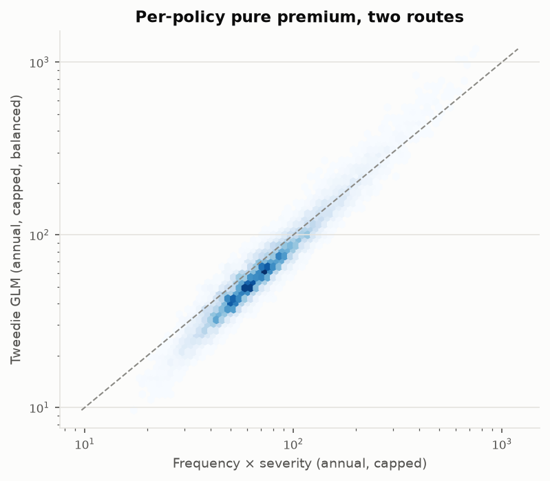
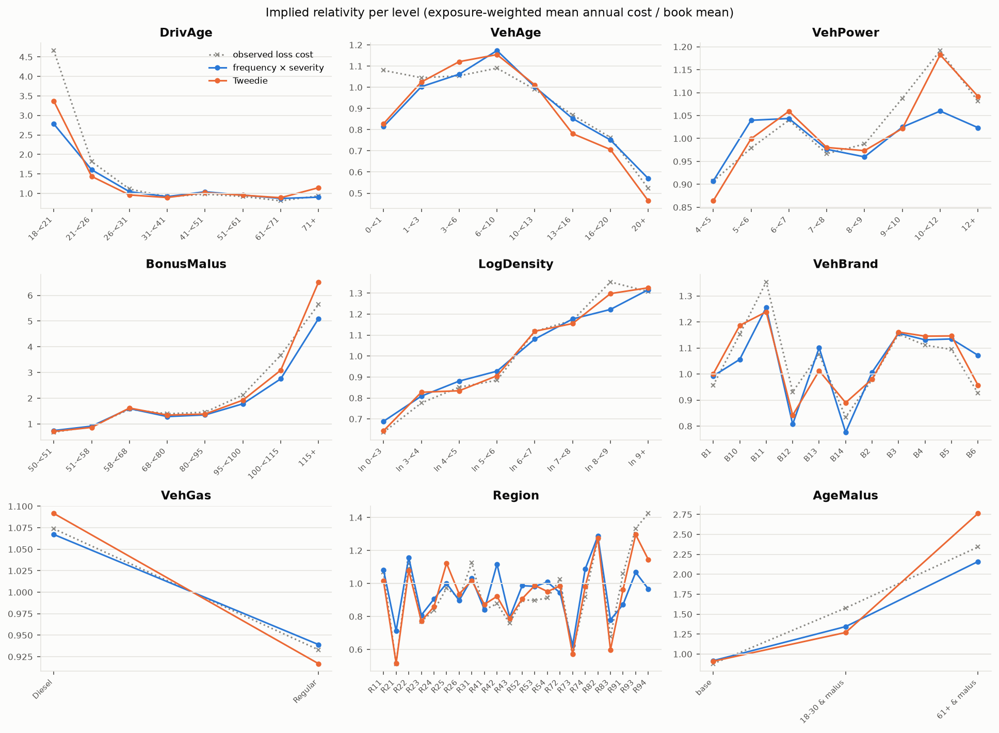

<!-- GENERATED by `fremtpl2 report` - do not edit by hand. -->
# Pure premium (phase 3)

Generated 2026-10-30. Training split (542,600 policies); holdout comparisons follow in phase 4.
Interpretation: `docs/methodology.md` §2c; decisions D-005, D-012, D-014, D-015.

**Pure premium** = annual frequency (full-year cover) × expected severity per claim (full-year claim) ×
(1 + large-loss loading 0.3781). Exposure-weighted mean on the training book: **108.74**
per policy-year. Expenses, profit margin and the short-record loading are added in phase 6.

**Tweedie cross-check**: Tweedie GLM on capped loss cost per exposure-year, var_weight = exposure, same tariff
factors and exposure-band control as the frequency model. Power p = 1.761, implied by the
severity dispersion (compound Poisson–Gamma: p = (ν+2)/(ν+1), ν = 1/φ). Uncorrected Tweedie A/E on total
capped losses = 0.9666; its intercept is rebalanced so fitted total = actual.

## 1. Reconciliation to actual losses (training book)

| model      | basis                                                      |   expected |    actual |    ae |
|:-----------|:-----------------------------------------------------------|-----------:|----------:|------:|
| freq x sev | fitted (record's own exposure band), capped losses         |  3.548e+07 | 3.553e+07 | 1.002 |
| freq x sev | priced at full-year rate, pro rata, capped losses          |  2.264e+07 | 3.553e+07 | 1.57  |
| freq x sev | priced, full-year records only, capped losses              |  1.004e+07 | 1.009e+07 | 1.005 |
| freq x sev | priced x (1 + large-loss loading), all losses incl. excess |  3.119e+07 | 4.897e+07 | 1.57  |
| tweedie    | fitted (record's own exposure band), capped losses         |  3.553e+07 | 3.553e+07 | 1     |
| tweedie    | priced at full-year rate, pro rata, capped losses          |  2.064e+07 | 3.553e+07 | 1.722 |
| tweedie    | priced, full-year records only, capped losses              |  8.974e+06 | 1.009e+07 | 1.124 |
| tweedie    | priced x (1 + large-loss loading), all losses incl. excess |  2.844e+07 | 4.897e+07 | 1.722 |

## 2. Where pure-premium variation comes from

Variance of log pure premium across training policies, split into frequency and severity parts:

| component      |   variance |   share_of_log_premium_variance |
|:---------------|-----------:|--------------------------------:|
| log frequency  |     0.2416 |                          0.9875 |
| log severity   |     0.0028 |                          0.0113 |
| 2 x covariance |     0.0003 |                          0.0012 |

## 3. Tweedie vs frequency × severity

| comparison                             |   corr_log_premium |   ratio_p05 |   ratio_median |   ratio_p95 |   share_policies_differ_gt_10pct |   share_policies_differ_gt_20pct |
|:---------------------------------------|-------------------:|------------:|---------------:|------------:|---------------------------------:|---------------------------------:|
| tweedie / freq x sev (as priced)       |             0.9678 |      0.6840 |         0.8580 |      1.1516 |                           0.6962 |                           0.3456 |
| same, both rescaled to equal book mean |             0.9678 |      0.7501 |         0.9409 |      1.2629 |                           0.5639 |                           0.2031 |

Sensitivity of the Tweedie premium shape to the power parameter:

|   power |   base_power |   max_abs_relativity_change |   premium_ratio_p05 |   premium_ratio_p95 |
|--------:|-------------:|----------------------------:|--------------------:|--------------------:|
|  1.6607 |       1.7607 |                      0.0680 |              0.9727 |              1.0344 |
|  1.8607 |       1.7607 |                      0.0785 |              0.9652 |              1.0292 |

Implied relativities per level (both models and the observed loss cost, each divided by its own book mean):

| factor     | level         |    exposure |   observed |   freq_x_sev |   tweedie |
|:-----------|:--------------|------------:|-----------:|-------------:|----------:|
| DrivAge    | 18-<21        |   2,065.352 |      4.664 |        2.782 |     3.369 |
| DrivAge    | 21-<26        |  10,987.054 |      1.816 |        1.606 |     1.437 |
| DrivAge    | 26-<31        |  23,234.421 |      1.111 |        1.044 |     0.960 |
| DrivAge    | 31-<41        |  67,292.925 |      0.914 |        0.917 |     0.894 |
| DrivAge    | 41-<51        |  70,442.091 |      0.980 |        1.041 |     1.020 |
| DrivAge    | 51-<61        |  60,603.284 |      0.922 |        0.957 |     0.953 |
| DrivAge    | 61-<71        |  30,706.440 |      0.809 |        0.870 |     0.889 |
| DrivAge    | 71+           |  21,543.435 |      0.937 |        0.903 |     1.146 |
| VehAge     | 0-<1          |  13,316.812 |      1.080 |        0.815 |     0.828 |
| VehAge     | 1-<3          |  49,865.618 |      1.045 |        1.003 |     1.025 |
| VehAge     | 3-<6          |  57,690.094 |      1.054 |        1.062 |     1.121 |
| VehAge     | 6-<10         |  62,562.902 |      1.090 |        1.173 |     1.154 |
| VehAge     | 10-<13        |  44,682.290 |      0.990 |        1.002 |     1.011 |
| VehAge     | 13-<16        |  34,485.036 |      0.869 |        0.852 |     0.781 |
| VehAge     | 16-<20        |  18,533.009 |      0.763 |        0.751 |     0.706 |
| VehAge     | 20+           |   5,739.239 |      0.522 |        0.569 |     0.464 |
| VehPower   | 4-<5          |  47,953.352 |      0.907 |        0.907 |     0.864 |
| VehPower   | 5-<6          |  54,584.984 |      0.979 |        1.040 |     0.999 |
| VehPower   | 6-<7          |  65,991.024 |      1.040 |        1.044 |     1.059 |
| VehPower   | 7-<8          |  62,471.492 |      0.967 |        0.976 |     0.980 |
| VehPower   | 8-<9          |  18,117.770 |      0.988 |        0.960 |     0.973 |
| VehPower   | 9-<10         |  12,323.097 |      1.088 |        1.025 |     1.022 |
| VehPower   | 10-<12        |  19,159.221 |      1.192 |        1.060 |     1.182 |
| VehPower   | 12+           |   6,274.062 |      1.081 |        1.024 |     1.092 |
| BonusMalus | 50-<51        | 180,276.906 |      0.676 |        0.743 |     0.710 |
| BonusMalus | 51-<58        |  28,268.947 |      0.902 |        0.913 |     0.865 |
| BonusMalus | 58-<68        |  23,936.250 |      1.571 |        1.599 |     1.619 |
| BonusMalus | 68-<80        |  22,699.675 |      1.396 |        1.287 |     1.344 |
| BonusMalus | 80-<95        |  18,305.959 |      1.456 |        1.351 |     1.385 |
| BonusMalus | 95-<100       |   5,530.356 |      2.129 |        1.783 |     1.925 |
| BonusMalus | 100-<115      |   6,404.249 |      3.673 |        2.754 |     3.088 |
| BonusMalus | 115+          |   1,452.658 |      5.649 |        5.099 |     6.520 |
| LogDensity | ln 0-<3       |  17,270.938 |      0.637 |        0.689 |     0.643 |
| LogDensity | ln 3-<4       |  36,925.422 |      0.776 |        0.809 |     0.827 |
| LogDensity | ln 4-<5       |  50,007.271 |      0.851 |        0.881 |     0.835 |
| LogDensity | ln 5-<6       |  51,305.258 |      0.884 |        0.928 |     0.906 |
| LogDensity | ln 6-<7       |  45,632.602 |      1.117 |        1.081 |     1.118 |
| LogDensity | ln 7-<8       |  39,349.192 |      1.171 |        1.177 |     1.155 |
| LogDensity | ln 8-<9       |  34,231.177 |      1.353 |        1.222 |     1.298 |
| LogDensity | ln 9+         |  12,153.142 |      1.307 |        1.316 |     1.326 |
| VehBrand   | B1            |  76,269.103 |      0.956 |        0.992 |     1.001 |
| VehBrand   | B10           |   7,601.787 |      1.152 |        1.056 |     1.186 |
| VehBrand   | B11           |   5,515.017 |      1.353 |        1.256 |     1.239 |
| VehBrand   | B12           |  51,824.371 |      0.932 |        0.807 |     0.841 |
| VehBrand   | B13           |   5,440.233 |      1.076 |        1.101 |     1.013 |
| VehBrand   | B14           |   1,802.084 |      0.835 |        0.776 |     0.890 |
| VehBrand   | B2            |  75,993.926 |      0.978 |        1.007 |     0.980 |
| VehBrand   | B3            |  22,796.151 |      1.153 |        1.157 |     1.161 |
| VehBrand   | B4            |  10,949.271 |      1.111 |        1.131 |     1.145 |
| VehBrand   | B5            |  16,085.921 |      1.094 |        1.135 |     1.146 |
| VehBrand   | B6            |  12,597.138 |      0.926 |        1.072 |     0.957 |
| VehGas     | Diesel        | 136,450.386 |      1.074 |        1.067 |     1.092 |
| VehGas     | Regular       | 150,424.615 |      0.933 |        0.939 |     0.917 |
| Region     | R11           |  24,125.784 |      1.069 |        1.082 |     1.015 |
| Region     | R21           |     969.444 |      0.514 |        0.712 |     0.517 |
| Region     | R22           |   2,863.026 |      1.120 |        1.158 |     1.078 |
| Region     | R23           |   2,562.149 |      0.769 |        0.808 |     0.772 |
| Region     | R24           |  82,228.065 |      0.837 |        0.906 |     0.859 |
| Region     | R25           |   5,317.884 |      0.971 |        1.000 |     1.123 |
| Region     | R26           |   4,025.915 |      0.913 |        0.897 |     0.936 |
| Region     | R31           |   9,234.818 |      1.125 |        1.030 |     1.018 |
| Region     | R41           |   6,513.891 |      0.840 |        0.842 |     0.873 |
| Region     | R42           |     983.688 |      0.878 |        1.117 |     0.922 |
| Region     | R43           |     444.667 |      0.758 |        0.794 |     0.786 |
| Region     | R52           |  17,636.894 |      0.900 |        0.986 |     0.908 |
| Region     | R53           |  22,157.134 |      0.898 |        0.983 |     0.988 |
| Region     | R54           |   8,879.454 |      0.912 |        1.008 |     0.951 |
| Region     | R72           |  11,469.810 |      1.024 |        0.943 |     0.985 |
| Region     | R73           |   5,627.784 |      0.588 |        0.625 |     0.571 |
| Region     | R74           |   1,912.202 |      0.917 |        1.088 |     0.983 |
| Region     | R82           |  36,321.102 |      1.272 |        1.287 |     1.275 |
| Region     | R83           |   1,868.939 |      0.679 |        0.779 |     0.598 |
| Region     | R91           |  11,765.740 |      1.058 |        0.873 |     0.964 |
| Region     | R93           |  28,540.187 |      1.333 |        1.068 |     1.296 |
| Region     | R94           |   1,426.422 |      1.425 |        0.967 |     1.145 |
| AgeMalus   | base          | 245,215.933 |      0.879 |        0.917 |     0.910 |
| AgeMalus   | 18-30 & malus |  34,373.623 |      1.577 |        1.344 |     1.270 |
| AgeMalus   | 61+ & malus   |   7,285.445 |      2.342 |        2.160 |     2.763 |
