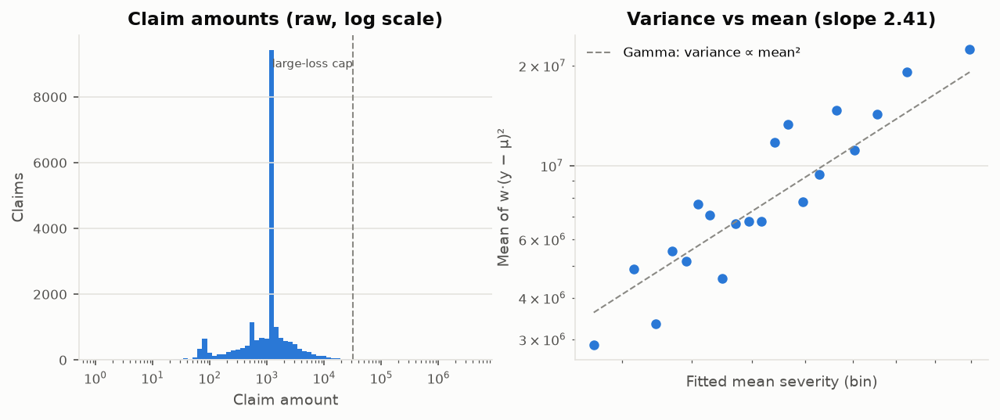
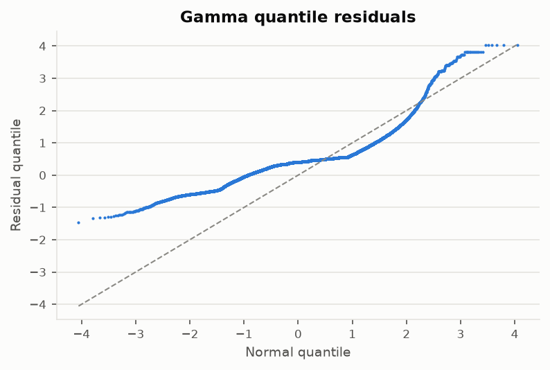

<!-- GENERATED by `fremtpl2 report` - do not edit by hand. -->
# Severity model (phase 3)

Generated 2026-10-30. Training split only: 19,998 policies with at least one claim,
21,191 claims (3.7% of the 542,600 policies
in the frequency model). Response: average *capped* claim amount per policy, var_weight = number of claims.
Interpretation: `docs/methodology.md` §2b; decisions D-013, D-014.

Selected model: Gamma GLM, log link, tariff factor(s) **VehAge**, control
ExposureBand (fitted, pinned at full year when pricing). Pearson dispersion φ = 3.178.
Base severity (full-year claim, reference levels): **1,415**.

## 1. Distribution

| amounts   |   claims |   mean |   median |     cv |   skewness |   p90 |       p99 |       max |   policies_with_claims |   share_of_frequency_rows |
|:----------|---------:|-------:|---------:|-------:|-----------:|------:|----------:|----------:|-----------------------:|--------------------------:|
| raw       |   21,191 |  2,311 |    1,172 | 14.04  |    101.3   | 2,781 | 1.636e+04 | 4.075e+06 |                 19,998 |                   0.03686 |
| capped    |   21,191 |  1,677 |    1,172 |  1.852 |      6.964 | 2,781 | 1.636e+04 | 3.216e+04 |                 19,998 |                   0.03686 |

Amounts that recur in at least 2% of claims (flat-rate settlements):

|     amount |     claims |   share |
|-----------:|-----------:|--------:|
| 1,204.0000 | 3,817.0000 |  0.1801 |
| 1,128.1200 | 2,470.0000 |  0.1166 |
| 1,172.0000 | 1,664.0000 |  0.0785 |
| 1,128.0000 |   658.0000 |  0.0311 |

## 2. Severity by exposure band of the claiming record

| band           |   claims |    amount |    fitted |    priced |   observed_mean_severity |   ae_fitted |   ae_priced_at_full_year |
|:---------------|---------:|----------:|----------:|----------:|-------------------------:|------------:|-------------------------:|
| (0, 0.0833]    |      848 | 2.13e+06  | 2.132e+06 | 1.151e+06 |                    2,512 |      0.9993 |                    1.851 |
| (0.0833, 0.25] |    1,952 | 4.123e+06 | 4.126e+06 | 2.66e+06  |                    2,112 |      0.9992 |                    1.55  |
| (0.25, 0.5]    |    4,004 | 7.721e+06 | 7.713e+06 | 5.48e+06  |                    1,928 |      1.001  |                    1.409 |
| (0.5, 0.75]    |    3,805 | 6.323e+06 | 6.331e+06 | 5.224e+06 |                    1,662 |      0.9988 |                    1.21  |
| (0.75, 0.999]  |    3,213 | 5.146e+06 | 5.15e+06  | 4.414e+06 |                    1,602 |      0.9991 |                    1.166 |
| (0.999, 1]     |    7,369 | 1.009e+07 | 1.008e+07 | 1.008e+07 |                    1,369 |      1.001  |                    1.001 |

## 3. Factor selection

Drop-one quasi-F tests in the full starting model:

| factor       |   df |   delta_deviance |       F |       p_F |
|:-------------|-----:|-----------------:|--------:|----------:|
| VehBrand     |   10 |           20.82  |  0.6788 | 0.7453    |
| AgeMalus     |    2 |            2.034 |  0.3316 | 0.7178    |
| VehGas       |    1 |            1.057 |  0.3446 | 0.5572    |
| LogDensity   |    3 |            6.615 |  0.719  | 0.5405    |
| DrivAge      |    3 |           21.25  |  2.31   | 0.07424   |
| VehPower     |    2 |           18.53  |  3.021  | 0.04879   |
| BonusMalus   |    3 |           26.07  |  2.833  | 0.03675   |
| Region       |   21 |          124.3   |  1.93   | 0.006432  |
| VehAge       |    2 |           67.31  | 10.97   | 1.724e-05 |
| ExposureBand |    5 |          609.1   | 39.72   | 9.133e-41 |

Backward elimination path (each step drops the least significant tariff factor; `f_test_rule` shows what a
pure p < 0.05 rule would do):

|   step | factors_before                                                                        |   dispersion | dropped    |       p_F | f_test_rule   |
|-------:|:--------------------------------------------------------------------------------------|-------------:|:-----------|----------:|:--------------|
|      1 | DrivAge, VehAge, VehPower, BonusMalus, LogDensity, VehBrand, VehGas, Region, AgeMalus |        3.067 | VehBrand   | 0.7453    | dropped       |
|      2 | DrivAge, VehAge, VehPower, BonusMalus, LogDensity, VehGas, Region, AgeMalus           |        3.082 | AgeMalus   | 0.6958    | dropped       |
|      3 | DrivAge, VehAge, VehPower, BonusMalus, LogDensity, VehGas, Region                     |        3.08  | LogDensity | 0.5347    | dropped       |
|      4 | DrivAge, VehAge, VehPower, BonusMalus, VehGas, Region                                 |        3.087 | VehGas     | 0.456     | dropped       |
|      5 | DrivAge, VehAge, VehPower, BonusMalus, Region                                         |        3.089 | VehPower   | 0.02946   | kept          |
|      6 | DrivAge, VehAge, BonusMalus, Region                                                   |        3.096 | BonusMalus | 0.016     | kept          |
|      7 | DrivAge, VehAge, Region                                                               |        3.1   | Region     | 0.01349   | kept          |
|      8 | DrivAge, VehAge                                                                       |        3.149 | DrivAge    | 0.0008725 | kept          |
|      9 | VehAge                                                                                |        3.178 | VehAge     | 0.0001131 | kept          |

Grouped 5-fold CV deviance along that path. The chosen model is the smallest whose paired CV deviance difference
to the best model is within one paired standard error:

|   n_factors | factors                                                                                             |   cv_mean_deviance |   cv_se | has_controls   |   diff_vs_best |   paired_se_vs_best |   folds_worse_than_best | best   | chosen_one_se   |
|------------:|:----------------------------------------------------------------------------------------------------|-------------------:|--------:|:---------------|---------------:|--------------------:|------------------------:|:-------|:----------------|
|           9 | DrivAge, VehAge, VehPower, BonusMalus, LogDensity, VehBrand, VehGas, Region, AgeMalus, ExposureBand |            1.08548 | 0.02386 | True           |        0.00586 |             0.00392 |                       4 | False  | False           |
|           8 | DrivAge, VehAge, VehPower, BonusMalus, LogDensity, VehGas, Region, AgeMalus, ExposureBand           |            1.08332 | 0.02402 | True           |        0.00370 |             0.00377 |                       3 | False  | False           |
|           7 | DrivAge, VehAge, VehPower, BonusMalus, LogDensity, VehGas, Region, ExposureBand                     |            1.08203 | 0.02391 | True           |        0.00241 |             0.00350 |                       3 | False  | False           |
|           6 | DrivAge, VehAge, VehPower, BonusMalus, VehGas, Region, ExposureBand                                 |            1.08168 | 0.02415 | True           |        0.00205 |             0.00344 |                       3 | False  | False           |
|           5 | DrivAge, VehAge, VehPower, BonusMalus, Region, ExposureBand                                         |            1.08138 | 0.02416 | True           |        0.00175 |             0.00328 |                       3 | False  | False           |
|           4 | DrivAge, VehAge, BonusMalus, Region, ExposureBand                                                   |            1.08090 | 0.02370 | True           |        0.00128 |             0.00217 |                       3 | False  | False           |
|           3 | DrivAge, VehAge, Region, ExposureBand                                                               |            1.08104 | 0.02400 | True           |        0.00142 |             0.00118 |                       4 | False  | False           |
|           2 | DrivAge, VehAge, ExposureBand                                                                       |            1.07962 | 0.02299 | True           |        0.00000 |             0.00000 |                       0 | True   | False           |
|           1 | VehAge, ExposureBand                                                                                |            1.08076 | 0.02375 | True           |        0.00114 |             0.00148 |                       3 | False  | True            |
|           0 | ExposureBand                                                                                        |            1.08269 | 0.02237 | True           |        0.00307 |             0.00145 |                       5 | False  | False           |
|           0 | (intercept only)                                                                                    |            1.11203 | 0.02403 | False          |        0.03241 |             0.00386 |                       5 | False  | False           |

## 4. Relativities (cluster-robust 95% CI)

| factor       | level          | is_reference   | is_control   |   relativity |   ci_low |   ci_high |    claims |         amount |   observed_severity |
|:-------------|:---------------|:---------------|:-------------|-------------:|---------:|----------:|----------:|---------------:|--------------------:|
| VehAge       | 0-<3           | False          | False        |        1.010 |    0.948 |     1.075 | 4,590.000 |  8,236,723.900 |           1,794.493 |
| VehAge       | 3-<10          | True           | False        |        1.000 |    1.000 |     1.000 | 9,410.000 | 15,980,761.170 |           1,698.274 |
| VehAge       | 10+            | False          | False        |        0.898 |    0.849 |     0.949 | 7,191.000 | 11,315,626.920 |           1,573.582 |
| ExposureBand | (0, 0.0833]    | False          | True         |        1.852 |    1.633 |     2.100 |   848.000 |  2,130,440.405 |           2,512.312 |
| ExposureBand | (0.0833, 0.25] | False          | True         |        1.551 |    1.414 |     1.703 | 1,952.000 |  4,123,209.069 |           2,112.300 |
| ExposureBand | (0.25, 0.5]    | False          | True         |        1.408 |    1.311 |     1.511 | 4,004.000 |  7,720,841.884 |           1,928.282 |
| ExposureBand | (0.5, 0.75]    | False          | True         |        1.212 |    1.130 |     1.299 | 3,805.000 |  6,322,961.139 |           1,661.751 |
| ExposureBand | (0.75, 0.999]  | False          | True         |        1.167 |    1.083 |     1.257 | 3,213.000 |  5,145,673.259 |           1,601.517 |
| ExposureBand | (0.999, 1]     | True           | True         |        1.000 |    1.000 |     1.000 | 7,369.000 | 10,089,986.233 |           1,369.248 |

## 5. Gamma assumption checks

Variance vs mean (log-log slope of binned w·(y−μ)² on fitted μ, full starting model):

|   variance_power |   ci_low |   ci_high |   r_squared | reference                                   |
|-----------------:|---------:|----------:|------------:|:--------------------------------------------|
|            2.408 |    1.922 |     2.894 |       0.858 | Poisson-like 1, Gamma 2, inverse Gaussian 3 |

Quantile residuals (should be N(0,1) if the Gamma distribution held): mean 0.381,
SD 0.541, skewness 1.517.

## 6. Cross-validation (grouped 5-fold, out-of-fold)

| model               |   mean_deviance_per_claim |   fold_sd |   ae_amount |   deviance_explained_vs_mean |   folds_better_than_mean |
|:--------------------|--------------------------:|----------:|------------:|-----------------------------:|-------------------------:|
| mean_severity       |                   1.11203 |   0.05373 |     1.00046 |                      0.00000 |                        0 |
| gamma_controls_only |                   1.08269 |   0.05002 |     1.00018 |                      0.02638 |                        5 |
| gamma_all_factors   |                   1.08548 |   0.05335 |     1.00118 |                      0.02388 |                        5 |
| gamma_selected      |                   1.08076 |   0.05311 |     1.00023 |                      0.02812 |                        5 |

## 7. Which factors matter for frequency vs severity

Drop-one quasi-F tests in each full model (frequency: fine bands, 542,600 policies;
severity: coarse bands, 19,998 policies with claims):

| factor       |   freq_df |   freq_quasi_F |    freq_p |   sev_df |   sev_quasi_F |     sev_p | matters_for_frequency   | matters_for_severity   |
|:-------------|----------:|---------------:|----------:|---------:|--------------:|----------:|:------------------------|:-----------------------|
| AgeMalus     |         2 |         44.61  | 4.262e-20 |        2 |        0.3316 | 0.7178    | True                    | False                  |
| BonusMalus   |         7 |        343     | 0         |        3 |        2.833  | 0.03675   | True                    | True                   |
| DrivAge      |         7 |         53.56  | 6.103e-77 |        3 |        2.31   | 0.07424   | True                    | False                  |
| ExposureBand |         5 |        178     | 6.02e-190 |        5 |       39.72   | 9.133e-41 | True                    | True                   |
| LogDensity   |         7 |         27.54  | 3.924e-38 |        3 |        0.719  | 0.5405    | True                    | False                  |
| Region       |        21 |          7.458 | 9.689e-23 |       21 |        1.93   | 0.006432  | True                    | True                   |
| VehAge       |         7 |         31.45  | 6.241e-44 |        2 |       10.97   | 1.724e-05 | True                    | True                   |
| VehBrand     |        10 |         23.6   | 4.92e-45  |       10 |        0.6788 | 0.7453    | True                    | False                  |
| VehGas       |         1 |         61.38  | 4.706e-15 |        1 |        0.3446 | 0.5572    | True                    | False                  |
| VehPower     |         7 |          6.704 | 5.772e-08 |        2 |        3.021  | 0.04879   | True                    | True                   |
