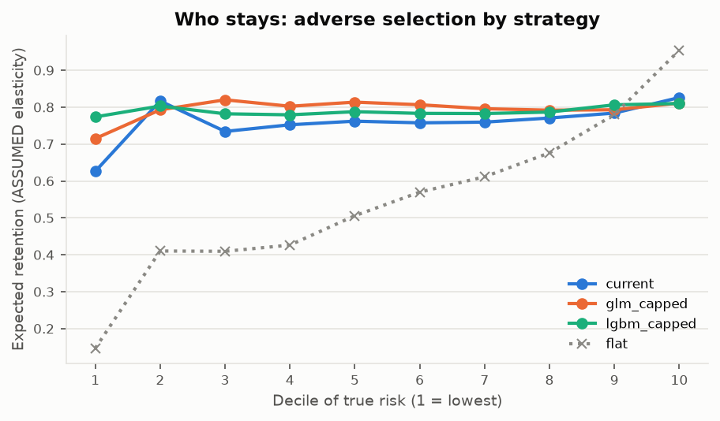
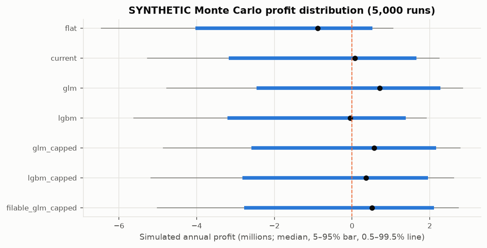

<!-- GENERATED by `fremtpl2 report` - do not edit by hand. -->
# Pricing strategy simulation (phase 6)

Generated 2026-10-31. **Everything below that depends on customer behaviour is SYNTHETIC and rests on
ASSUMED parameters** (no price, lapse or competitor data exist for freMTPL2). Figures are estimates under stated
assumptions, not achievable savings. Interpretation: `docs/methodology.md` §7; decisions D-023 to D-026.

**Book.** The 135,413 holdout policies (71,485 exposure-years, actual losses incl. large losses
10,941,685) renew for one year with their observed exposure. The holdout is independent of every
fitted model.

**Base-case assumptions** (`pricing` in `configs/config.yaml`): expense ratio 25%, profit margin
5%, current tariff = one_factor_BonusMalus, caps ±15%, reference truth = blend,
retention logit = logit(0.85) + -3.0·log(new/current) + -4.0·log(new/market).

**Comparison basis.** Every strategy is scaled to collect the same total premium from the full book (the true
expected cost / (1 − expenses − margin)), so strategies differ only in *how* premium is spread. Two profit views:
*expected* (claims = model-based true cost, D-024) and *realised* (claims = the actual holdout losses of the
policies, weighted by their retention probability: model-free, but noisy).

## 1. Duration terms (training split; D-012, D-014, D-017)

| band           |   short_period_glm |   short_period_lgbm |   short_period_filable_glm |   short_period_flat |   short_period_current |   large_loss_loading |
|:---------------|-------------------:|--------------------:|---------------------------:|--------------------:|-----------------------:|---------------------:|
| (0, 0.0833]    |             4.7515 |              3.3157 |                     4.5797 |              4.7515 |                 4.7515 |               0.4822 |
| (0.0833, 0.25] |             3.2131 |              2.3707 |                     3.1684 |              3.2131 |                 3.2131 |               0.4822 |
| (0.25, 0.5]    |             2.1509 |              1.6612 |                     2.1158 |              2.1509 |                 2.1509 |               0.4822 |
| (0.5, 0.75]    |             1.6635 |              1.2747 |                     1.6462 |              1.6635 |                 1.6635 |               0.4822 |
| (0.75, 0.999]  |             1.4822 |              1.1869 |                     1.4655 |              1.4822 |                 1.4822 |               0.4822 |
| (0.999, 1]     |             1.0000 |              1.0000 |                     1.0000 |              1.0000 |                 1.0000 |               0.1155 |

## 2. Strategy outcomes (base case)

| strategy           |   retention_exposure |         premium |   loss_ratio |          profit |   profit_margin |   realised_loss_ratio_actual_losses |   realised_profit_actual_losses |   risk_mix_index |
|:-------------------|---------------------:|----------------:|-------------:|----------------:|----------------:|------------------------------------:|--------------------------------:|-----------------:|
| flat               |               0.5133 |  8,537,277.0746 |       0.8932 | -1,222,889.5358 |         -0.1432 |                              0.8787 |                 -1,099,166.9257 |           1.3577 |
| current            |               0.7757 | 11,522,601.8122 |       0.7719 |   -251,849.0593 |         -0.0219 |                              0.7649 |                   -171,454.1462 |           1.0479 |
| glm                |               0.7970 | 11,921,603.1950 |       0.7159 |    406,584.3868 |          0.0341 |                              0.7419 |                     96,078.6173 |           0.9787 |
| lgbm               |               0.8043 | 10,151,032.8344 |       0.7891 |   -396,754.2706 |         -0.0391 |                              0.7447 |                     54,250.2707 |           0.9102 |
| glm_capped         |               0.8020 | 12,333,034.5971 |       0.7310 |    234,091.9254 |          0.0190 |                              0.7292 |                    256,836.6533 |           1.0274 |
| lgbm_capped        |               0.8055 | 11,979,521.5513 |       0.7447 |     63,464.4602 |          0.0053 |                              0.7463 |                     44,316.5212 |           1.0122 |
| filable_glm_capped |               0.7980 | 12,254,199.3836 |       0.7342 |    193,934.5487 |          0.0158 |                              0.7341 |                    194,774.2338 |           1.0304 |

Customer impact and selection (price change vs current tariff; premium / true cost at the 10th and 90th
percentile of policies):

| strategy           |   mean_abs_change_vs_current |   share_up_gt_10pct |   share_up_gt_25pct |   share_down_gt_10pct |   retention_lowest_risk_decile |   retention_highest_risk_decile |   premium_to_true_cost_p10 |   premium_to_true_cost_p90 |
|:-------------------|-----------------------------:|--------------------:|--------------------:|----------------------:|-------------------------------:|--------------------------------:|---------------------------:|---------------------------:|
| flat               |                       0.4204 |              0.6660 |              0.5660 |                0.3340 |                         0.1465 |                          0.9542 |                     0.6106 |                     1.9912 |
| current            |                       0.0000 |              0.0000 |              0.0000 |                0.0000 |                         0.6260 |                          0.8261 |                     0.6623 |                     1.6867 |
| glm                |                       0.2691 |              0.3690 |              0.2318 |                0.4005 |                         0.8431 |                          0.7195 |                     0.8290 |                     1.2300 |
| lgbm               |                       0.3456 |              0.2942 |              0.1943 |                0.5201 |                         0.9496 |                          0.6947 |                     0.5679 |                     1.3868 |
| glm_capped         |                       0.1241 |              0.4178 |              0.0000 |                0.3537 |                         0.7149 |                          0.8111 |                     0.7522 |                     1.4642 |
| lgbm_capped        |                       0.1286 |              0.3874 |              0.0000 |                0.4224 |                         0.7737 |                          0.8099 |                     0.6968 |                     1.5382 |
| filable_glm_capped |                       0.1232 |              0.4142 |              0.0000 |                0.3470 |                         0.7053 |                          0.8169 |                     0.7453 |                     1.4889 |

Expected retention by decile of true risk (ASSUMED elasticity):

|   risk_decile |   flat |   current |   glm |   lgbm |   glm_capped |   lgbm_capped |   filable_glm_capped |
|--------------:|-------:|----------:|------:|-------:|-------------:|--------------:|---------------------:|
|         1.000 |  0.146 |     0.626 | 0.843 |  0.950 |        0.715 |         0.774 |                0.705 |
|         2.000 |  0.410 |     0.817 | 0.744 |  0.835 |        0.793 |         0.803 |                0.792 |
|         3.000 |  0.409 |     0.734 | 0.840 |  0.802 |        0.820 |         0.782 |                0.810 |
|         4.000 |  0.426 |     0.752 | 0.865 |  0.821 |        0.803 |         0.779 |                0.797 |
|         5.000 |  0.506 |     0.762 | 0.844 |  0.809 |        0.814 |         0.788 |                0.807 |
|         6.000 |  0.570 |     0.758 | 0.833 |  0.798 |        0.807 |         0.783 |                0.801 |
|         7.000 |  0.611 |     0.759 | 0.814 |  0.790 |        0.796 |         0.783 |                0.792 |
|         8.000 |  0.676 |     0.771 | 0.787 |  0.781 |        0.792 |         0.787 |                0.791 |
|         9.000 |  0.780 |     0.784 | 0.748 |  0.785 |        0.793 |         0.806 |                0.790 |
|        10.000 |  0.954 |     0.826 | 0.719 |  0.695 |        0.811 |         0.810 |                0.817 |

## 3. SYNTHETIC Monte Carlo (5,000 runs)

Claim counts per exposure band ~ Poisson(systemic shock × retained expected claims); severities resampled from
training claim amounts incl. large losses (D-016); systemic shock lognormal with sd
5%. Profit = premium × (1 − expense ratio) − claims.

| strategy           |         premium |     mean_profit |      sd_profit |   prob_loss |      profit_p05 |    profit_p50 |       var_99_5 |      tvar_99_5 |   var_99_5_pct_premium |
|:-------------------|----------------:|----------------:|---------------:|------------:|----------------:|--------------:|---------------:|---------------:|-----------------------:|
| flat               |  8,537,277.0746 | -1,218,925.3564 | 1,442,595.5353 |      0.8078 | -4,035,026.2245 | -881,720.6421 | 6,456,706.3095 | 7,078,174.9385 |                 0.7563 |
| current            | 11,522,601.8122 |   -244,399.1728 | 1,509,603.9810 |      0.4808 | -3,177,087.4674 |   72,366.6744 | 5,261,781.1525 | 6,060,385.6667 |                 0.4566 |
| glm                | 11,921,603.1950 |    388,307.3738 | 1,490,700.0762 |      0.3360 | -2,455,901.5858 |  707,876.2493 | 4,770,342.6477 | 5,526,652.3907 |                 0.4001 |
| lgbm               | 10,151,032.8344 |   -385,699.8502 | 1,461,646.6631 |      0.5180 | -3,208,903.2572 |  -48,327.8162 | 5,618,939.6265 | 6,576,173.6406 |                 0.5535 |
| glm_capped         | 12,333,034.5971 |    258,355.8440 | 1,505,355.4998 |      0.3584 | -2,590,604.8774 |  567,563.2349 | 4,859,116.1376 | 5,567,324.1932 |                 0.3940 |
| lgbm_capped        | 11,979,521.5513 |     57,605.1895 | 1,512,117.4696 |      0.4030 | -2,827,164.6399 |  359,288.1995 | 5,183,664.1607 | 6,204,966.0176 |                 0.4327 |
| filable_glm_capped | 12,254,199.3836 |    188,898.9411 | 1,536,489.2778 |      0.3784 | -2,779,088.0538 |  515,369.4583 | 5,014,328.1758 | 5,848,209.3717 |                 0.4092 |

## 4. Sensitivity (one assumption at a time)

Realised profit on actual holdout losses:

| parameter            | value   |       flat |   current |      glm |     lgbm |   glm_capped |   lgbm_capped |   filable_glm_capped |
|:---------------------|:--------|-----------:|----------:|---------:|---------:|-------------:|--------------:|---------------------:|
| elasticity_scale     | 0.5     |   -276,011 |   225,054 |  384,175 |  303,821 |      447,556 |       367,893 |              417,827 |
| elasticity_scale     | 1.0     | -1,099,167 |  -171,454 |   96,079 |   54,250 |      256,837 |        44,317 |              194,774 |
| elasticity_scale     | 2.0     | -1,762,686 |  -640,925 | -285,481 | -165,174 |      -76,338 |      -391,239 |             -161,454 |
| actual_expense_ratio | 0.2     |   -672,303 |   404,676 |  692,159 |  561,802 |      873,488 |       643,293 |              807,484 |
| actual_expense_ratio | 0.25    | -1,099,167 |  -171,454 |   96,079 |   54,250 |      256,837 |        44,317 |              194,774 |
| actual_expense_ratio | 0.3     | -1,526,031 |  -747,584 | -500,002 | -453,301 |     -359,815 |      -554,660 |             -417,936 |
| cap                  | 0.25    | -1,099,167 |  -171,454 |   96,079 |   54,250 |      300,907 |       111,072 |              220,477 |
| cap                  | 0.05    | -1,099,167 |  -171,454 |   96,079 |   54,250 |       30,791 |       -68,923 |               25,281 |
| cap                  | 0.1     | -1,099,167 |  -171,454 |   96,079 |   54,250 |      177,544 |        -5,573 |              138,378 |
| cap                  | 0.15    | -1,099,167 |  -171,454 |   96,079 |   54,250 |      256,837 |        44,317 |              194,774 |
| reference_truth      | blend   | -1,099,167 |  -171,454 |   96,079 |   54,250 |      256,837 |        44,317 |              194,774 |
| reference_truth      | glm     | -1,077,720 |    62,959 |  464,038 |  201,798 |      545,373 |       360,552 |              475,468 |
| reference_truth      | lgbm    | -1,092,719 |  -378,368 | -241,436 | -120,194 |      -60,210 |      -153,962 |             -103,842 |

Expected profit under the reference truth:

| parameter            | value   |       flat |   current |       glm |     lgbm |   glm_capped |   lgbm_capped |   filable_glm_capped |
|:---------------------|:--------|-----------:|----------:|----------:|---------:|-------------:|--------------:|---------------------:|
| elasticity_scale     | 0.5     |   -422,761 |   205,448 |   546,324 |   49,447 |      457,444 |       376,471 |              438,740 |
| elasticity_scale     | 1.0     | -1,222,890 |  -251,849 |   406,584 | -396,754 |      234,092 |        63,464 |              193,935 |
| elasticity_scale     | 2.0     | -1,726,116 |  -773,321 |   200,441 | -736,156 |     -119,066 |      -377,207 |             -183,392 |
| actual_expense_ratio | 0.2     |   -796,026 |   324,281 | 1,002,665 |  110,797 |      850,744 |       662,441 |              806,645 |
| actual_expense_ratio | 0.25    | -1,222,890 |  -251,849 |   406,584 | -396,754 |      234,092 |        63,464 |              193,935 |
| actual_expense_ratio | 0.3     | -1,649,753 |  -827,979 |  -189,496 | -904,306 |     -382,560 |      -535,512 |             -418,775 |
| cap                  | 0.25    | -1,222,890 |  -251,849 |   406,584 | -396,754 |      377,808 |        99,599 |              318,072 |
| cap                  | 0.05    | -1,222,890 |  -251,849 |   406,584 | -396,754 |      -47,822 |      -105,247 |              -61,671 |
| cap                  | 0.1     | -1,222,890 |  -251,849 |   406,584 | -396,754 |      112,967 |        -1,625 |               85,371 |
| cap                  | 0.15    | -1,222,890 |  -251,849 |   406,584 | -396,754 |      234,092 |        63,464 |              193,935 |
| reference_truth      | blend   | -1,222,890 |  -251,849 |   406,584 | -396,754 |      234,092 |        63,464 |              193,935 |
| reference_truth      | glm     | -1,281,814 |  -104,213 |   614,475 | -723,419 |      416,736 |        84,176 |              378,118 |
| reference_truth      | lgbm    | -1,394,140 |  -674,281 |  -125,450 | -256,214 |     -272,872 |      -283,611 |             -307,305 |

Full sensitivity table: `reports/tables/SYNTHETIC_sim_sensitivity.csv`.
